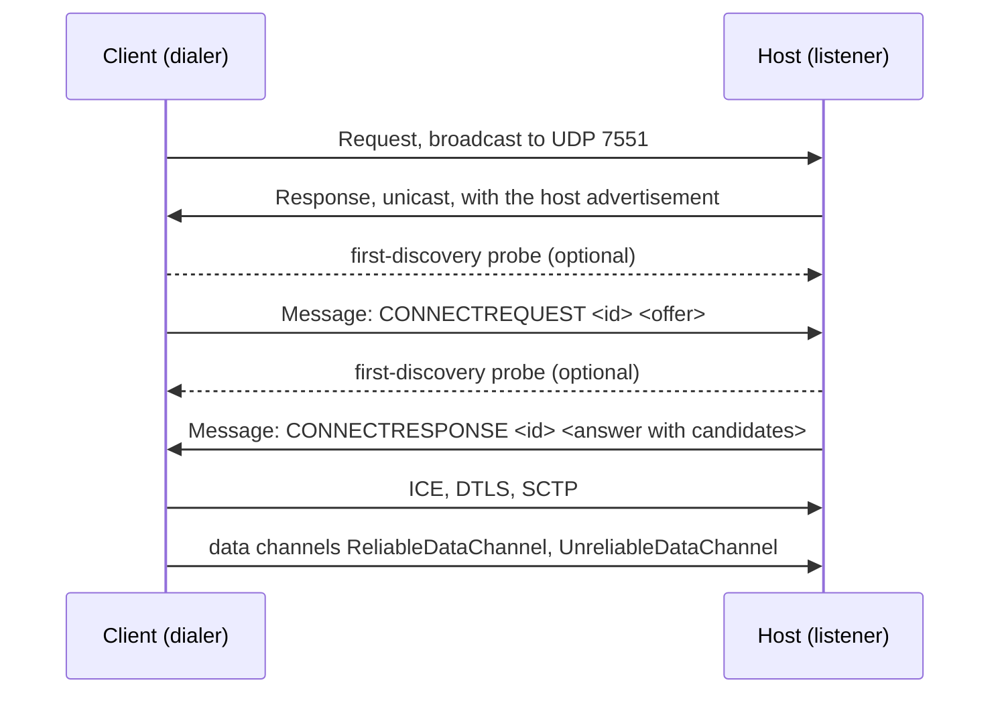
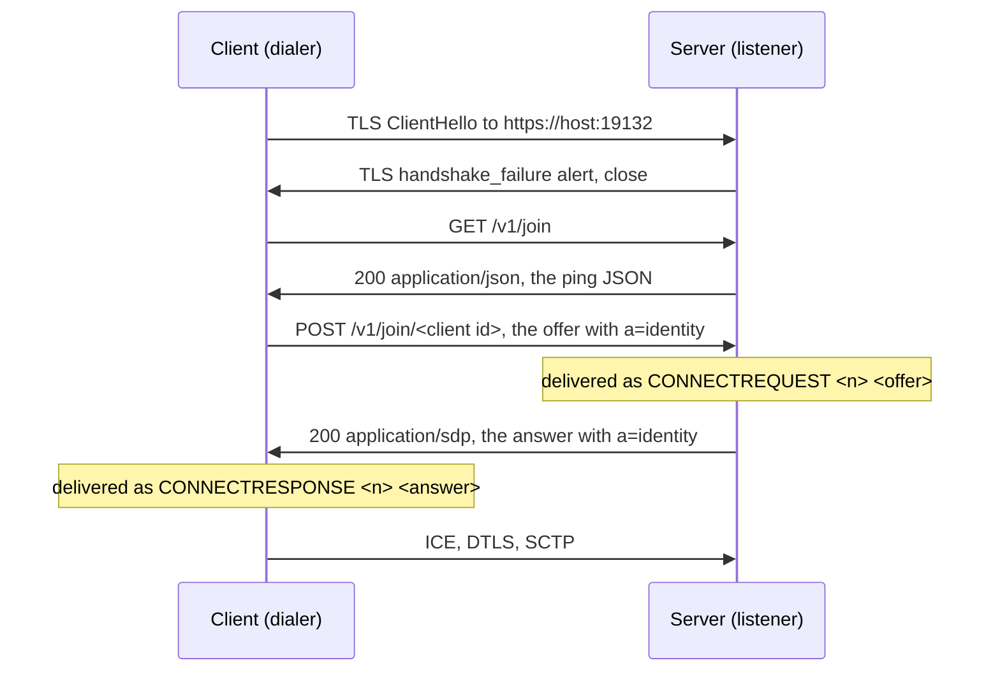
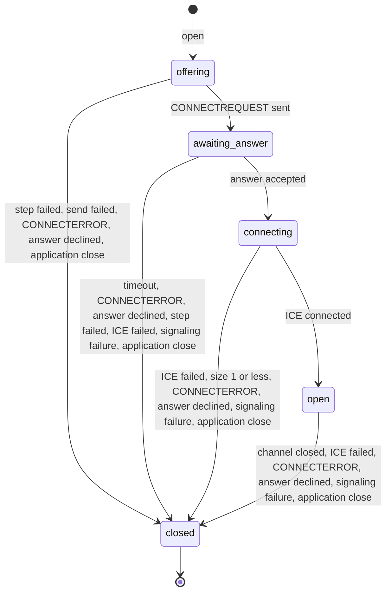
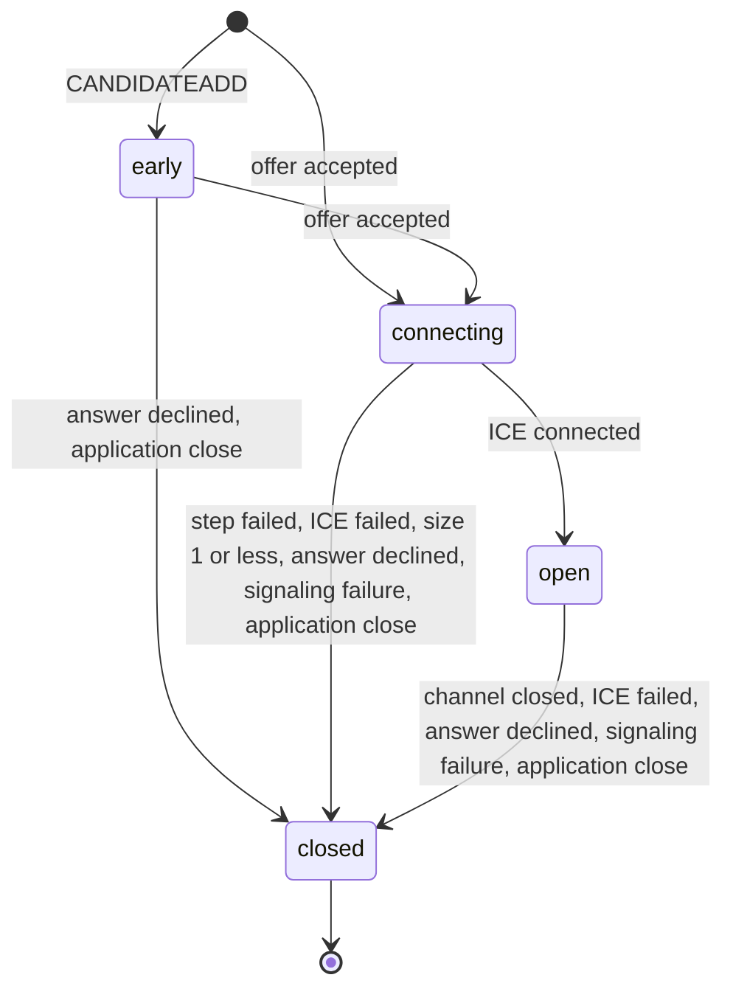

# NetherNet Transport

| | |
| --- | --- |
| Version | 1.0.0 |
| Date | 2026-11-19 |
| Status | Draft |
| Baseline | Minecraft Bedrock 1.26.60: the dedicated server (BDS) 1.26.60 and the 1.26.60 client |
| License | MIT, as the rest of this repository |

This document specifies the NetherNet transport as Minecraft Bedrock 1.26.60 speaks it: LAN discovery, the signaling messages and the channels that carry them, the identity assertions in SDP, the WebRTC session and the framing of game packets on its data channels. It is written so that an interoperable implementation can be built from it alone. It ships with nethernet-python, a Python implementation of the NetherNet transport, together with machine-readable test vectors in `tests/vectors/`.

## Contents

1. [Introduction](#1-introduction)
2. [Terminology](#2-terminology)
3. [Architecture Overview](#3-architecture-overview)
4. [Identifiers](#4-identifiers)
5. [Signaling Messages](#5-signaling-messages)
6. [Signaling Channels](#6-signaling-channels)
7. [LAN Discovery](#7-lan-discovery)
8. [LAN Discovery Encryption](#8-lan-discovery-encryption)
9. [Identity Assertions](#9-identity-assertions)
10. [WebRTC Session](#10-webrtc-session)
11. [Data-Channel Framing](#11-data-channel-framing)
12. [Session Lifecycle](#12-session-lifecycle)
13. [Error Codes](#13-error-codes)
14. [Constants, Defaults and Host Configuration](#14-constants-defaults-and-host-configuration)
15. [Security Considerations](#15-security-considerations)
16. [Interoperability Notes](#16-interoperability-notes)
17. [References](#17-references)
- [Appendix A. Test Vectors](#appendix-a-test-vectors)
- [Appendix B. Implementation Notes (nethernet-python)](#appendix-b-implementation-notes-nethernet-python)

## 1. Introduction

### 1.1. Scope

NetherNet carries Bedrock game packets between two peers over WebRTC data channels. A connection uses three planes:

- signaling, which exchanges the SDP offer, the SDP answer and ICE candidates as text messages (Sections 5 and 6);
- the WebRTC transport, which runs ICE, DTLS and SCTP and frames packets on two data channels (Sections 10 and 11);
- LAN discovery, which finds hosts on the local network and also carries signaling between LAN peers (Sections 7 and 8).

Section 12 joins them into a session lifecycle.

Out of scope:

- the Bedrock game protocol carried above the transport;
- the online signaling service (a WebSocket and JSON-RPC service used for friend, invite, Realms and featured-server joins), beyond the few values that refer to it;
- RakNet.

### 1.2. Requirements Language

The key words "MUST", "MUST NOT", "REQUIRED", "SHALL", "SHALL NOT", "SHOULD", "SHOULD NOT", "RECOMMENDED", "NOT RECOMMENDED", "MAY", and "OPTIONAL" in this document are to be interpreted as described in BCP 14 [RFC2119] [RFC8174] when, and only when, they appear in all capitals, as shown here.

### 1.3. Conformance

An implementation conforms when it produces and accepts the bytes and the message orders this document defines.

Everything outside the sections marked "This section is informative." and the appendices is normative. A statement whose subject is BDS or the client reports the observed behaviour of the baseline build. It is not a requirement on other implementations, and the requirements around it say what a peer does to interoperate with it.

Each requirement applies to the conformance classes whose sections hold it:

| Class | Role | Sections |
| --- | --- | --- |
| Dialer | the peer that opens a session, the WebRTC offerer | 4.4, 5, 6.1, 9.3 to 9.6, 9.8, 10, 11, 12 |
| Listener | the peer that receives the opening `CONNECTREQUEST`, the WebRTC answerer | 4.4, 5, 6.1, 9.3 to 9.5, 9.7, 9.8, 10, 11, 12 |
| LAN endpoint | a peer that sends and receives LAN discovery datagrams | 6.2, 7, 8 |
| HTTP signaling server | a listener that accepts offers over HTTP | 6.3.2 to 6.3.5 |
| HTTP signaling client | a dialer that sends offers over HTTP | 6.3.1, 6.3.6, 12.5 |

Sections 4.1 to 4.3, 9.1 and 9.2 apply to every class that reads or writes the forms they define. BDS and the client each carry both the dialer and the listener role, and a session takes its role from which side opens it.

### 1.4. Notational Conventions

#### 1.4.1. Datatypes

| Type | Size | Definition |
| --- | --- | --- |
| `u8` | 1 | unsigned 8-bit integer |
| `u16` | 2 | unsigned 16-bit integer, little-endian |
| `u32` | 4 | unsigned 32-bit integer, little-endian |
| `u64` | 8 | unsigned 64-bit integer, little-endian |
| `bytes[n]` | n | n raw bytes |
| `bool` | 1 | a `u8`, 0 for false and 1 for true |
| `varint` | 1 or more | an unsigned integer in 7-bit groups, least significant group first, each byte's high bit set when another byte follows |
| `zigzag` | 1 or more | a signed integer `n` written as the `varint` of `2n` when `n >= 0` and `-2n - 1` otherwise |
| `text` | 1 or more | a `varint` byte length followed by that many bytes |

The fixed-width integers NetherNet defines are little-endian. The host advertisement (Section 7.5) carries only `varint`, `zigzag`, `text` and single-byte values, the fragment header (Section 11.1) is one byte, and signaling messages carry numbers as decimal text, so none of these has a byte order. The standard protocols keep their own byte order: STUN, DTLS and SCTP use network order, and the JWK members `x`, `y`, `n` and `e` are big-endian.

#### 1.4.2. Byte Layouts

Binary layouts are offset tables with the columns Offset, Size, Field, Type and Description, listed in wire order. Offsets and sizes are in bytes. There is no padding unless a row says so.

#### 1.4.3. Grammars

Text formats are given in ABNF [RFC5234]. Quoted strings in ABNF are case-insensitive; `%s"..."` marks a case-sensitive string [RFC7405]. The core rules `ALPHA`, `DIGIT`, `HEXDIG`, `SP`, `HTAB`, `CR`, `LF`, `CRLF` and `OCTET` are those of [RFC5234].

#### 1.4.4. Algorithms

Procedures are numbered steps in the style of the WHATWG specifications. "Drop" means discard the input silently: nothing is sent back and nothing is reported. "Abort these steps" ends the procedure at once.

#### 1.4.5. Version Baseline

Every statement in this document describes Minecraft Bedrock 1.26.60. No feature in this version carries a per-feature version tag.

## 2. Terminology

Application id
: A `u64` shared by LAN peers. It keys LAN discovery encryption (Section 8).

Connection id
: A `u64` that names a session at one end of a signaling channel (Section 4.4).

Dialer
: The peer that opens a session by sending `CONNECTREQUEST`. It is the WebRTC offerer.

Early session
: A listener session that a `CANDIDATEADD` created before any `CONNECTREQUEST` for its pair (Section 12.1).

Fragment
: One data-channel message: a one-byte header and part or all of a game packet (Section 11).

Fragment size
: The largest payload one fragment carries (Section 11.2).

Host
: A peer that answers LAN discovery Requests or serves HTTP signaling.

Identity signer
: The key, and for a player also the token, that the application gives a peer to sign the identity assertion of its local description (Section 9).

LAN-visible
: Of a host: with LAN visibility on, so that it answers discovery Requests (Section 14).

Listener
: The peer that receives a `CONNECTREQUEST` and answers it. It is the WebRTC answerer.

NetworkID
: The identifier of a peer (Section 4).

Peer table
: A LAN endpoint's map from sender id to address (Section 7.8).

Server list
: The client's list of servers, which probes each server for its ping JSON (Section 6.3.1).

Session
: One connection attempt between two peers, keyed by the pair (remote NetworkID, connection id).

Signaling channel
: A path that carries signaling messages between two NetworkIDs: LAN signaling (Section 6.2), HTTP signaling (Section 6.3) or the online signaling service.

Sweep
: A periodic pass over all sessions that closes failed and timed-out ones (Section 12.7).

Trickle peer
: A peer with trickle ICE on. It sends its SDP once the local description is set and then each candidate as its own `CANDIDATEADD` (Section 12.5).

## 3. Architecture Overview

This section is informative.

A dialer reaches a listener in one of two ways. A host found by LAN discovery is signaled over LAN: each signaling message travels as the data of an encrypted LAN discovery Message datagram. A host named by IP address or hostname is probed over HTTP and, once a probe answers, signaled over HTTP: the offer is the body of a `POST` and the answer is its response. Joins through friends, invites, Realms and featured servers use the online signaling service, which this document does not cover.

After signaling both peers run standard WebRTC. The dialer creates two data channels, `ReliableDataChannel` and `UnreliableDataChannel`. Game packets are framed on them as Section 11 describes.

A LAN join:



The client broadcasts a Request on the discovery port. The host answers with a Response that carries its advertisement. Each side may probe a peer it records for the first time. The client sends its offer in a Message, and the host answers in a Message with an SDP that carries every candidate. ICE, DTLS and SCTP then run directly between the peers, and the client opens both data channels.

An HTTP join:



The client probes `https://` URLs first. BDS speaks plain HTTP and fails the TLS handshake, so the plain `http://` probe wins. The client posts its signed offer to `/v1/join/` followed by its own NetworkID. The server turns the request into a `CONNECTREQUEST`, and the first signal it sends back for that session becomes the response.

## 4. Identifiers

### 4.1. NetworkID Forms

A NetworkID has one of three forms:

| Form | Value | String form |
| --- | --- | --- |
| P2P | `u64` | unsigned decimal, as `1234567890` |
| Realms | 128-bit UUID | lowercase hex in `8-4-4-4-12` groups, most significant digit first |
| unset | none | the empty string |

- A P2P id MUST print as unsigned decimal with no sign, padding or leading zeros, so 0 prints `0`.
- LAN discovery and LAN signaling carry only the P2P form, as a raw `u64`.
- The id in an HTTP signaling path is always P2P. A Realms id reaches BDS from the network only through online signaling.
- An unset id is invalid. A P2P id of 0 and the nil UUID parse but are invalid.
- Two ids are equal only when they have the same form and the same value. Unset equals unset.

### 4.2. Parsing a NetworkID String

To parse a NetworkID string `s`:

1. If `s` is empty, return unset.
2. If every character of `s` is an ASCII decimal digit and the value fits a `u64`, return P2P with that value. Leading zeros are allowed.
3. If `s` is exactly 32 hex digits, or 36 characters with `-` at offsets 8, 13, 18 and 23 and hex digits elsewhere, in either case, return Realms. The first 16 hex digits are the most significant half. The 32-digit form parses to the same UUID as its dashed form.
4. Otherwise return unset.

Parsing never fails. Consequences: `"123abc"`, `" 123"`, `"+1"` and `"-1"` are not P2P; a 32-digit decimal string overflows a `u64` and so parses as Realms; braced, `urn:uuid:` and every other UUID form are unset.

### 4.3. NetworkID in JSON

Written, a P2P id is a JSON number, a Realms id its string form and an unset id `null`.

Read, the JSON type picks the form:

- An integer literal from -2^63 to 2^64 - 1 is an integer. A non-negative integer is P2P with that value. A negative integer `-n` is P2P `2^64 - n`, so `-1` is `18446744073709551615`.
- `true` is P2P 1 and `false` is P2P 0.
- A real truncates toward zero to a signed 64-bit integer and keeps only its low 32 bits: `1.5` and `1.0` give P2P 1, `5e9` gives P2P 705032704 and `-1.0` gives P2P 4294967295.
- An integer literal outside that range reads as a real and gives P2P 0. A real at or above 2^63, a real below -2^63, NaN and an infinity give P2P 0 the same way. So `-0.5` gives P2P 0, `4294967296.0` gives P2P 0 and `4294967297.9` gives P2P 1.
- A string parses as Section 4.2 says.
- `null`, an array or an object is unset.

### 4.4. Connection Id

- The dialer MUST draw a fresh random `u64` connection id for each outgoing session. The id MAY be 0, and a receiver MUST NOT reject it.
- On LAN signaling the id travels in every signaling message of the session, and the listener MUST answer with the same id.
- Over HTTP signaling the id does not travel. The client posts only the data of each signal (Section 6.3.6). The server numbers each accepted POST with a session id of its own, delivers the offer under that id (Section 6.3.5) and answers in the same HTTP response, which the client delivers under the connection id of the signal it posted. A connection id therefore names a session at one end of a channel, and the HTTP channel maps the client's id to the server's.
- Two remotes may use the same connection id at once, since a session is keyed by the pair (remote NetworkID, connection id).
- BDS draws no random NetworkID of either form. Its only random id is the connection id.

### 4.5. Correlation Id

The correlation id renders a NetworkID for logs and for the multiplayer correlation id of the game's StartGame packet, which carries the correlation id of the server's own NetworkID. It never appears in signaling or LAN discovery.

- A P2P id renders as `<nethernet>WWWW-WWWW-WWWW-WWWW`: the four 16-bit words of the `u64`, most significant first, each as 4 lowercase hex digits.
- A Realms id renders as `<nethernet>` followed by its string form.
- An invalid id (unset, P2P 0 or the nil UUID) renders as the empty string.

## 5. Signaling Messages

### 5.1. Format

A signaling message is one string. A sender MUST produce this form:

```abnf
signal          = identifier SP connection-id SP data
identifier      = %s"CONNECTREQUEST" / %s"CONNECTRESPONSE"
                / %s"CANDIDATEADD" / %s"CONNECTERROR"
connection-id   = "0" / ( %x31-39 *DIGIT )   ; a u64 in decimal
data            = *OCTET                     ; runs to the end of the string
error-data      = [ "-" ] ( "0" / ( %x31-39 *DIGIT ) )
                                             ; CONNECTERROR data, a signed 32-bit value
```

There is no trailing newline. `data` is the SDP or candidate text verbatim, with no escaping, and may contain spaces, CR and LF. For `CONNECTERROR`, `data` is `error-data`.

### 5.2. Messages

| Identifier | Direction | `data` |
| --- | --- | --- |
| `CONNECTREQUEST` | dialer to listener | the SDP offer |
| `CONNECTRESPONSE` | listener to dialer | the SDP answer |
| `CANDIDATEADD` | either | one ICE candidate |
| `CONNECTERROR` | either | an error code (Section 13) in signed decimal |

The table holds every identifier. The receiver of `CONNECTREQUEST` applies `data` as the remote offer, and the receiver of `CONNECTRESPONSE` as the remote answer.

`CANDIDATEADD` carries one candidate in the standard WebRTC form: the SDP `candidate` attribute [RFC8839] without its `a=` prefix and line end, as `candidate:<foundation> <component> <protocol> <priority> <ip> <port> typ <type> ...`, extensions such as `generation`, `ufrag`, `network-id` and `network-cost` included. It is not a NetherNet format, and a standard WebRTC stack parses it.

### 5.3. Parsing

A receiver MUST parse a message with these steps. Any failure drops the message: nothing is sent back and no error is reported.

1. Find the first space, then the next space after it. If either is missing, fail. A message therefore needs three tokens.
2. The identifier is the text before the first space. If it does not equal one of the four identifiers exactly, case included, fail.
3. The connection id token is the text between the two spaces. If it is empty, fail.
4. Read the connection id as base-10 digits up to the first non-digit. If no digit is read, or the value exceeds the `u64` range, fail. Trailing characters are ignored, so `CONNECTREQUEST 123abc ...` carries id 123. A leading sign or space fails.
5. `data` is everything after the second space, spaces and newlines included. It may be empty.
6. For `CONNECTERROR`, read `data` as an optional `-` followed by decimal digits up to the first non-digit, as a signed 32-bit value. Trailing characters are ignored. If no digit is read, `data` starts with `+` or a space, or the value is outside the signed 32-bit range, fail.

## 6. Signaling Channels

### 6.1. Channel Contract and Selection

A signaling channel sends a message string from a local NetworkID to a remote one and surfaces each inbound (sender, message) pair. An inbound message from a channel other than LAN is not filtered by its addressee.

Whether another signaling channel is set is a property of the endpoint, never of the remote. Only LAN reachability, whether the remote is in the peer table (Section 7.8), is per remote. A peer MUST choose the channel for each outgoing message as follows:

1. If LAN signaling is off, send over the other signaling channel, or fail with no signaling channel (24) when none is set.
2. Otherwise, if another signaling channel is set, send over LAN when the session prefers LAN and the remote is in the peer table, and over the other channel otherwise.
3. Otherwise, send over LAN when the remote is in the peer table, and fail with no signaling channel (24) otherwise.

An incoming session prefers the channel its `CONNECTREQUEST` came on, so a session opened over LAN answers over LAN, its declining `CONNECTERROR` included. An outgoing session has no preference and uses the other channel when one is set.

- A send for a session that no longer exists fails with signaling send failure (26).
- A LAN send never reports an error.
- A failed send closes the session with the error it reports.
- A delivery error a channel reports later closes the session with that error, except unicast delivery failure (19), which closes only an outgoing session. An error for a session already gone is dropped.

A client that joins a host picked from LAN discovery signals over LAN only. A client that joins an IP target probes it over HTTP (Section 6.3.1) and signals over HTTP once a probe answers.

### 6.2. LAN Signaling

- LAN signaling carries the whole message string as the message data of a LAN discovery Message packet (Section 7.6), with the sender id set to the local id and the recipient id to the target.
- A sender MUST unicast it to the target's recorded address and MUST NOT broadcast it.
- A target with no live record in the peer table gets nothing, and the send reports no session error. Section 6.1 chooses LAN only for a remote in the peer table, and a record expires when a lookup finds it older than 60 s (Section 7.8), so this case arises when the record expires between that choice and the send.
- A message that does not fit 1140 bytes still goes out whole in one datagram (Section 7.6).

### 6.3. HTTP Signaling

The routes follow Mojang's public NetherNet onboarding guide [NETHERNET-GUIDE]. The HTTP channel carries only the SDP or candidate text and rebuilds the signaling message at each end.

#### 6.3.1. Probing

An HTTP signaling client MUST find the base URL for host `H` and port `P` as follows:

1. If an earlier probe of `H:P` succeeded, use its URL alone.
2. Otherwise, if `P` is neither 0 nor 19132, the first batch is `https://H:P` and the fallback batch `http://H:P`.
3. Otherwise the first batch is `https://H:19132`, `https://H` and the fallback batch `http://H:19132`, `http://H`.
4. Start every URL of the first batch at once. The first to succeed wins. List order sets only the start order.
5. If no URL of the first batch succeeds, run the fallback batch the same way.
6. The first URL that succeeds is cached for `H:P` and becomes the base URL.
7. The whole probe times out after 6 s. If every URL fails, the join fails.

An IPv6 literal host is bracketed, as `https://[::1]:25565`.

The direct-join probe is `GET <url>/v1/join` with no query and no extra headers, and a 3 s timeout per request. Any 2xx answer without a transport error succeeds, and the body is ignored, so a host whose `GET /v1/join` body is empty still passes.

The server list uses a different probe, `GET <url>/v1/join?version=<game version>`, which needs a 2xx answer with a non-empty body that parses as the ping JSON (Section 6.3.4).

#### 6.3.2. Request Syntax

The HTTP signaling server speaks plain HTTP/1.1. It MUST accept requests of this form and MUST close the connection without a response on anything else:

```abnf
request         = request-line *header-line CRLF body
request-line    = method SP path SP version CRLF
method          = 1*16%x41-5A                ; A to Z
path            = "/" *path-byte
path-byte       = %x00-09 / %x0B-0C / %x0E-1F / %x21-FF
                                             ; a literal space ends the path
version         = *( %x00-09 / %x0B-0C / %x0E-FF )
                                             ; not checked
header-line     = *( %x00-09 / %x0B-0C / %x0E-FF ) CRLF
body            = *OCTET                     ; Content-Length bytes

content-length  = "content-length" ":" *( SP / HTAB ) 1*DIGIT *( SP / HTAB )
                                             ; a header-line, name in any case
```

- Lines end in CRLF. A request with LF-only line endings never completes and meets the 30 s receive timeout.
- The `Content-Length` name matches in any case, with no space before the colon. A header line with a space before the colon is not a `Content-Length`. The value, trimmed of spaces and tabs, MUST be an unsigned decimal with no sign and nothing after it, within the `u64` range. Leading zeros are allowed.
- A repeated `Content-Length` with the same value is accepted. A different value, or any other malformed value, closes the connection without a response.
- No `Content-Length` means an empty body. `Transfer-Encoding: chunked` is ignored.
- The server waits for the whole body.
- A request of up to 65536 bytes, request line, headers and body together, is answered. A longer one closes the connection without a response.
- A connection that has not sent a whole request within 30 s is closed without a response.
- The path is not percent-decoded.

Routes:

```abnf
ping-route      = %s"GET" SP %s"/v1/join" [ "?" *path-byte ]
join-route      = %s"POST" SP %s"/v1/join/" network-id-text
network-id-text = *id-space [ "+" ] ( hex-id / octal-id / decimal-id )
id-space        = %x09-0D / SP
hex-id          = "0" "x" 1*HEXDIG           ; "x" in either case
octal-id        = "0" *%x30-37
decimal-id      = %x31-39 *DIGIT
```

`network-id-text` follows C `strtoull` with base 0. Its value MUST fit a `u64`. A `-`, no digits, a value over the `u64` range or any byte after the number rejects it. The join route keeps the query string, so a `?` is such a trailing byte. So `0x10`, `010`, `+5` and a leading tab or vertical tab are accepted, `0x0` and `00` are the id 0, and `0x`, `08`, `-5`, `%35`, `%20%205` and 2^64 are rejected. The ping route ignores a query string. BDS keeps the query string on the join route, so `POST /v1/join/5?x=1` gets the 400 `Expected /v1/join/{networkId}`. A server MAY instead strip and ignore the query string on every route before routing and parsing the id. Vanilla clients send no query on a POST.

#### 6.3.3. Connection Handling

- A response is `HTTP/1.1 <status> <reason>`, then `Content-Type` when there is one, `Content-Length` and `Connection: close`, each line ending in CRLF, then an empty line and the body.
- The server closes the connection after writing a response. There is no keep-alive. A second request on the same connection, pipelined or sent after the answer, is dropped with the connection.
- A client that half-closes its side gets no answer.
- BDS holds at most 64 open connections. It accepts the 65th and later and closes them at once, without a response.
- When the first two bytes of a connection are `16 03`, the server sends the 7 bytes `15 03 01 00 02 02 28`, a fatal TLS `handshake_failure` alert, and closes. An `https://` request therefore fails its handshake.

#### 6.3.4. Responses

`GET /v1/join` answers `200 OK` with `Content-Type: application/json` and the ping JSON, for example:

```json
{"name":"Dedicated Server","protocol":2225,"version":"1.26.60","level":"Bedrock level","players":0,"maxPlayers":10,"gameType":0}
```

The body is empty when LAN visibility is off (Section 14).

`POST /v1/join/{networkId}` carries the dialer's offer SDP as its body, `{networkId}` the dialer's own NetworkID. The server MUST check the id before the body, and MUST answer:

| Case | Status line | Content-Type | Body |
| --- | --- | --- | --- |
| `{networkId}` rejected (Section 6.3.2) | `400 Expected /v1/join/{networkId}` | `text/plain` | `Expected /v1/join/{networkId}` |
| `{networkId}` is 0 | `400 Invalid networkId` | `text/plain` | `Invalid networkId` |
| empty body | `400 Missing SDP offer in request body` | `text/plain` | `Missing SDP offer in request body` |
| any other method or path, `/` and `POST /v1/join` included | `404 Not Found` | `text/plain` | `Not Found` |
| no signal back within 10 s | `504 Gateway Timeout` | `text/plain` | `Gateway Timeout` |
| the request handler failed | `500 Internal Server Error` | none | empty, `Content-Length: 0` |
| the first signal back | `200 OK` | `application/sdp` | the signal's `data` |

- The reason phrase of each 400, 404 and 504 answer is its body.
- `PATCH` and `HEAD` get the 404 like any other method, and a `HEAD` answer still carries its 9-byte body.
- The server never answers 405 or 503.

#### 6.3.5. Bridging a POST to Signaling

To handle an accepted `POST /v1/join/{networkId}` with body `B`:

1. Take the next session id. Session ids count up in decimal from 1, with no randomness, and only an accepted POST takes one.
2. Deliver `CONNECTREQUEST <session id> B` from the P2P NetworkID `{networkId}`, marked as having come over the signaling channel, not over LAN.
3. Hold the request open.
4. When the host sends its first signal to `{networkId}` with that session id, answer `200 OK`, `Content-Type: application/sdp`, with everything after the signal's second space as the body. The signal's type is not checked.
5. If no such signal comes within 10 s, answer `504 Gateway Timeout`.

Every later signal for that session id finds no pending request and is dropped silently. It is not queued, raises no error and is reported to the sender as success.

So a rejecting host's `CONNECTERROR <id> 37` answers `200 application/sdp` with the body `37`, not an SDP.

BDS checks the identity assertion of every offer that comes this way, whatever its `online-mode` setting, and answers an offer whose `a=identity` is missing or fails verification with identity not allowed (37). A dialer that joins BDS over HTTP therefore signs its offer (Section 6.3.6). An offer that passes the identity check but fails in WebRTC gets no signal back and ends in the 504.

#### 6.3.6. Client

An HTTP signaling client:

- MUST give the HTTP host a random `u64` NetworkID of its own. Answers are delivered from that id.
- MUST send each signal as `POST <base>/v1/join/<own NetworkID in decimal>` with `Content-Type: application/sdp`.
- MUST split the signal `<type> <session id> <data>` at its first two spaces and post only `<data>` as the body. It does not check the type. It reads the session id as Section 5.3 step 4 reads a connection id, so `ANYTHING 7abc data` posts `data` for session id 7.
- MUST NOT send `CANDIDATEADD`. It sends one offer with every candidate inline (Section 12.5).
- MUST sign its offer with an identity assertion (Section 9) to join BDS, which refuses an unsigned offer with identity not allowed (37) (Section 6.3.5).
- On a 2xx answer without a transport error, delivers a non-empty body as `CONNECTRESPONSE <session id> <body>` from the remote, `<session id>` that of the posted signal, without inspecting the body. It keeps no signal type, so this holds for the answer to any posted signal. An empty body delivers nothing.
- Fails the dial on any other answer:

| Answer | Error |
| --- | --- |
| 401 | not authenticated (38) |
| 403 | not allowed (39) |
| 503 | server full (40) |
| any other status, or a failed request | signaling send failure (26) |

A client MAY instead fail the dial on a 2xx body that does not start with `v=`. It then reports the code the body holds when the body reads as `CONNECTERROR` data (Section 5.3 step 6), and signaling parse failure (17) otherwise. A client MAY bound each POST by the negotiation timeout and report negotiation timeout (14) when it expires, where the table gives signaling send failure (26) for a failed request.

This paragraph is informative. The release client trickles over HTTP by default. Each `CANDIDATEADD` goes as its own POST whose body is the candidate, an attempt is one offer POST plus one POST per candidate, and none is retried. The HTTP signaling server delivers each such POST as a new `CONNECTREQUEST` with its own session id and no `a=identity` (Section 6.3.5), so BDS answers each one `200 application/sdp` with the body `37`. The release client delivers that body as a `CONNECTRESPONSE` for the session. It always runs HTTP signaling with an identity verifier, and no setting skips it, so that `CONNECTRESPONSE`, which carries no `a=identity` line, is declined and the session closes with identity not allowed (37), whatever the body says. The only state it checks is that the session exists, and it ignores a `CONNECTRESPONSE` for a session that no longer exists. BDS's own answer is a full-ICE SDP with every candidate inline, and no `CANDIDATEADD` follows (Section 12.5).

### 6.4. Online Signaling

This document does not specify the online signaling service. A dedicated server also signs in to it. Error codes 17, 18, 21, 25, 27 to 31, 33 and 35 come only from it (Section 13).

## 7. LAN Discovery

LAN peers find each other and exchange signaling over UDP with no server. Every datagram is sealed as Section 8 describes, so both peers need the same application id.

### 7.1. Socket

This section describes how BDS binds its LAN endpoint. Requests always go to the discovery port, so only an endpoint bound to it is discovered.

1. Create one UDP socket per LAN endpoint, IPv6 and dual stack: `IPV6_V6ONLY` 0, `SO_BROADCAST` 1, `SO_RCVBUF` 32768. Bind it to `[::]` on the discovery port, 7551 by default.
2. After the bind, join `ff02::1` on interface index 0 and set `IPV6_MULTICAST_LOOP` 0. Ignore a failure of either option, or of `SO_RCVBUF`.
3. If the IPv6 socket cannot be created, configured or bound for any reason but the port being in use, fall back to an IPv4 socket: `SO_BROADCAST` 1, `SO_RCVBUF` 32768, bound to `0.0.0.0` on the same port, with no multicast group.
4. If the port is in use, retry the whole sequence once on port 0, an ephemeral port. An in-use port on the IPv6 bind skips the IPv4 fallback.
5. Any other failure, or a failed retry, leaves the endpoint with no socket. It sends and receives nothing until the socket is rebuilt.

- `SO_REUSEADDR` is not set, so a second endpoint on the same host lands on an ephemeral port. BDS binds the discovery port exclusively: another process cannot bind it, even with `SO_REUSEADDR`.
- On the dual-stack socket an IPv4 destination goes out as its IPv4-mapped address `::ffff:a.b.c.d`. On the IPv4 socket an IPv6 destination fails with "address family not supported".
- A send that fails with a broken-pipe error drops the socket and builds a new one as above, trying the discovery port first.
- Peers learn an endpoint's real port from the UDP source address. Requests always go to the discovery port, so an endpoint on an ephemeral port gets Responses and Messages but no Requests.
- BDS binds the discovery port at startup and processes Messages and Responses whatever `enable-lan-visibility` says.

### 7.2. Base Header

Every packet starts with this 20-byte header:

| Offset | Size | Field | Type | Description |
| ---: | ---: | --- | --- | --- |
| 0 | 2 | packet length | `u16` | header size plus payload size, the payload size capped as Sections 7.4 and 7.6 say |
| 2 | 2 | packet type | `u16` | 0 Request, 1 Response, 2 Message |
| 4 | 8 | sender id | `u64` | the sender's P2P NetworkID |
| 12 | 8 | padding | `bytes[8]` | zero on send, ignored on receive |

The sender id sits at offset 4, unaligned. A naturally aligned layout is wrong on the wire.

### 7.3. Request

Type 0 is the base header alone, packet length 20. The sender id is the id enabled for broadcast discovery (Section 7.10).

### 7.4. Response

Type 1:

| Offset | Size | Field | Type | Description |
| ---: | ---: | --- | --- | --- |
| 0 | 20 | base header | | packet type 1 |
| 20 | 4 | application data length | `u32` | `min(N, 1148)` |
| 24 | N | application data | `bytes[N]` | the host advertisement (Section 7.5) |

With N bytes of application data, the sender MUST set the application data length to `min(N, 1148)` and the packet length to 24 plus that value. The datagram still carries all N bytes. The host fetches its advertisement again for each Request.

### 7.5. Host Advertisement

BDS's application data is the lowercase hex text of this binary record, so the application data length is twice the record size. The field labels are descriptive and do not appear on the wire.

| # | Field | Type | BDS value |
| ---: | --- | --- | --- |
| 1 | data version | `u8` | 7 |
| 2 | server name | `text`, UTF-8 | the server name |
| 3 | protocol version | `zigzag` | 2225 |
| 4 | game version | `text` | `1.26.60` |
| 5 | level name | `text` | the level name |
| 6 | player count | `zigzag` | players online |
| 7 | player limit | `zigzag` | the player limit |
| 8 | game type | `zigzag` | the level's game type |
| 9 | editor world | `bool` | whether the world is an editor world |
| 10 | hardcore | `bool` | whether the world is hardcore |
| 11 | online authentication | `bool` | online authentication on |
| 12 | self-signed authentication | `bool` | self-signed authentication on |
| 13 | advertisement nonce | `text` | a random `u64` in lowercase hex, no zero padding |
| 14 | connection type | `zigzag` | 4, or 7 while linked to the online signaling service |

- A receiver MUST NOT check the data version. It parses every record with the same 14 fields and drops only a record that fails to parse.
- A receiver MAY read a record as the release client does. The release client decodes the hex case-insensitively and validates no character, and an odd number of hex digits fails at the first byte and drops the record. What a pair that is not hex decodes to is unspecified. It ignores bytes after the last field and reads a `bool` as true for any non-zero byte. It reads a `varint` of at most 5 bytes, accepts a zero-padded form such as `80 00`, drops bits above 31 and fails the record on a sixth byte. It decodes a `zigzag` field on 32 bits.
- The connection type is not the transport: -1 undefined, 0 local, 1 IPv4, 2 IPv6, 3 plain WebSocket signaling, 4 LAN WebRTC signaling, 5 NAT, 6 UPnP, 7 JSON-RPC WebSocket signaling, 8 unknown IP. A host without a link to the online signaling service, such as a LAN or HTTP-only host, sends 4.
- The nonce is new at every restart. BDS checks it only when the advertisement updates: at startup, when a player joins or leaves, and when the player limit changes. An update more than 300 s of monotonic time after the nonce was drawn draws a new one, so an idle host keeps its nonce.
- A stock BDS record is 67 bytes, 134 hex characters, and a stock Response is 158 bytes.
- Under every configuration BDS advertises data version 7, protocol version 2225, game version `1.26.60`, player count 0, player limit 10, game type 0, editor world 0, hardcore 0, online authentication 1 and, when not linked, connection type 4. Self-signed authentication is 0 with `online-mode=true`, the shipped default, and 1 with `online-mode=false`.

### 7.6. Message

Type 2:

| Offset | Size | Field | Type | Description |
| ---: | ---: | --- | --- | --- |
| 0 | 20 | base header | | packet type 2 |
| 20 | 8 | recipient id | `u64` | the addressee's P2P NetworkID |
| 28 | 4 | message data length | `u32` | `min(N, 1140)` |
| 32 | N | message data | `bytes[N]` | one signaling message (Section 5) |

With N bytes of message data, the sender MUST set the message data length to `min(N, 1140)` and the packet length to 32 plus that value. 1140 caps only the length fields: a message over 1140 bytes, such as a full SDP, goes out whole in one datagram, and the receiver sizes it from the datagram. BDS accepts an 1870-byte offer whose header says 1140.

### 7.7. Receive

A LAN endpoint MUST process each received datagram with these steps:

1. Open the datagram (Section 8.3). If it is rejected, drop it.
2. If the plaintext is under 4 bytes, drop it.
3. If it is shorter than its packet length, drop it. A datagram longer than its packet length is accepted.
4. If the packet type is not 0, 1 or 2, drop it.
5. If it is shorter than its type's header, 20, 24 or 32 bytes, drop it.
6. The payload runs from the end of the header to the end of the datagram. The application data length and message data length are ignored, and an empty payload is valid.
7. If the packet is a Request:
   1. If its sender id is the local id, drop it. A Request with sender id 0 is answered.
   2. Reply with a Response whose sender id is the local id and whose application data is the current advertisement, unicast to the Request's source address and port. Ignore a failed reply.
   3. Abort these steps. A Request never updates the peer table.
8. If the sender id is not 0, update the peer table (Section 7.8) with the sender id and the datagram's source address and port, and send any first-discovery probe (Section 7.9).
9. If the packet is a Response and its sender id is not the local id, deliver the sender id and the application data to the application as a discovered host.
10. If the packet is a Message and its recipient id is the local id, deliver its data to signaling as a LAN message from the sender id. Drop a Message addressed to another id. A Message is never filtered on its sender id: one from the local id updates the peer table and gets the probe like any other.

A Request is answered whether or not the endpoint broadcasts Requests itself. BDS answers a Request sent to loopback, `255.255.255.255`, a directed broadcast, its unicast address or `[::1]` with one unicast Response from the discovery port.

### 7.8. Peer Table

- A record maps a sender id to an address and a last-active time.
- A Response or Message with a non-zero sender id adds its sender, or refreshes the record's time and replaces its address with the datagram's source address and port.
- Sender id 0 is never recorded.
- A record expires once 60 s pass since its last-active time. Expiry is checked on every lookup and update, with no timer.
- A peer is on the LAN while its record lives, manual hosts included.

Manual hosts, as BDS keeps them:

- Adding a LAN host by id, IP and port stores a record that never expires. On an existing record it replaces the address and makes the record permanent. It sends no probe.
- A later Response or Message from that id refreshes it like any peer, so it then expires 60 s after its last datagram.
- Removing a LAN host resets the record's time to now, so the peer stays reachable for 60 s more. Removing an id with no record does nothing.

### 7.9. First-Discovery Probe

When a Response or Message adds a new record, BDS sends that peer a Message with sender id 0, recipient id set to the peer, empty message data and packet length 32, to its recorded address. A refresh sends no probe, even when the address changed.

Sending the probe is OPTIONAL. Receiving one has no side effect: a zero sender id is never recorded, so no probe echoes back, and signaling drops the empty data because it has no space.

### 7.10. Broadcast Discovery

In BDS the application enables broadcast discovery per local id and disables it per id. Enabling an id twice does nothing. Enabling the first id runs a tick at once. Each tick re-arms itself one broadcast interval, 2 s, after it ends, with no backoff or jitter.

BDS runs each tick in order:

1. If no id is enabled, clear the broadcast addresses and stop. The tick is not re-armed.
2. If there are no broadcast addresses and no interface scan is running, start an interface scan. It completes later, so the first tick usually sends only to `255.255.255.255`.
3. For each enabled id, send one Request to each broadcast address, then one to `255.255.255.255`, each to the discovery port, never to the endpoint's own ephemeral port.
4. Re-arm.

Disabling every id and enabling one again before the pending tick runs starts a second tick chain, so Requests go out twice per interval.

An interface scan builds the broadcast addresses from every interface address:

- Skip loopback, `127.0.0.0/8` and `::1`.
- Skip IPv4 link-local, `169.254.0.0/16`.
- An IPv4 address adds its directed broadcast, the address with every host bit set. A prefix length of 0 or 32 adds the address itself.
- Any IPv6 address, link-local included, adds `ff02::1` once, on the dual-stack socket only. On the IPv4 socket an IPv6 address is skipped.

A finished scan replaces the set, and a scan that finds nothing leaves it empty. No timer refreshes the set: a new scan starts only on a tick that finds it empty, so an offline host scans every tick. A Request that fails with host unreachable, network unreachable, address family not supported or bad address removes that broadcast address. Other errors keep it, and `255.255.255.255` is never removed.

Who broadcasts:

- A dedicated server sends no Requests and answers each one. An idle BDS sent no datagram to a listener on the discovery port in 30 s.
- A client hosting a world does not broadcast. It answers Requests only while the world is LAN-visible.
- A client sends Requests only while it browses for LAN games.

### 7.11. Suspend and Resume

While BDS's LAN endpoint is suspended it sends, receives and ticks nothing, and its socket stays open. On resume it drops the socket, builds a new one as Section 7.1 says, and runs any overdue tick at once.

## 8. LAN Discovery Encryption

Every LAN discovery datagram is an encrypted, authenticated envelope, the first-discovery probe included.

### 8.1. Key

```
key = SHA-256(application id as a u64, 8 bytes little-endian)
```

The 32-byte `key` is both the AES-256 key [FIPS197] and the HMAC-SHA-256 key [RFC2104] [FIPS180-4]. Peers with different application ids cannot open each other's datagrams, so they never see each other. The default application id is `0xDEADBEEF`.

### 8.2. Envelope

| Offset | Size | Field | Type | Description |
| ---: | ---: | --- | --- | --- |
| 0 | 32 | MAC | `bytes[32]` | `HMAC-SHA-256(key, plaintext)` |
| 32 | 16k | ciphertext | `bytes[16k]` | `AES-256-ECB(key, PKCS7(plaintext))` |

The ciphertext is 16k bytes for some k >= 1. The plaintext is the whole discovery packet, header and payload. The envelope is the whole UDP payload. The MAC is over the plaintext, not the ciphertext. Padding is PKCS #7 [RFC5652] to the 16-byte block size. There is no IV, nonce, length prefix or version byte.

### 8.3. Seal and Open

To seal a packet plaintext `P`:

1. `MAC = HMAC-SHA-256(key, P)`.
2. `C = AES-256-ECB-encrypt(key, PKCS7-pad(P))`.
3. Send `MAC || C` as the datagram.

To open a datagram `D`:

1. If `D` is under 32 bytes, reject it.
2. Let the received MAC be the first 32 bytes of `D` and `C` the rest.
3. If `C` is not a whole number of 16-byte blocks, reject it.
4. `P = PKCS7-unpad(AES-256-ECB-decrypt(key, C))`. If unpadding fails, reject it.
5. Compute `HMAC-SHA-256(key, P)` and compare it with the received MAC in constant time. If they differ, reject it.
6. Return `P`.

A rejected datagram MUST be dropped silently.

## 9. Identity Assertions

Both directions of HTTP signaling can carry an identity assertion in the SDP: the offer asserts a player and the answer asserts the server operator's key. The envelope follows Mojang's public onboarding guide [NETHERNET-GUIDE].

### 9.1. Canonical JSON

Every JSON text [RFC8259] this section produces is compact, with no whitespace between tokens, and has its object keys sorted by the unsigned bytes of their UTF-8, which for valid UTF-8 is code point order. Strings escape only `"`, `\` and the bytes 0x01 to 0x1F: `\b`, `\t`, `\n`, `\f` and `\r` by name, the others as `\u00XX` with uppercase hex digits. Bytes from 0x80 up, 0x7F and `/` are written raw. A string or key is cut at its first 0x00 byte and the closing quote follows, so 0x00 is never escaped.

An integer is plain decimal with a leading `-` when negative, no `+` and no leading zeros. A non-integer number is printed as by the C format `%#.16g`, 16 significant digits that always include a decimal point, and then every trailing zero but the last one after the point is removed: `1.5` becomes `1.50`, `2.0` stays `2.0` and `0.1` becomes `0.10`. `%#.16g` prints the exponent form when the decimal exponent is below -4 or at least 16, and that form is left as printed.

The operator token's and the self-signed player token's header and payload JSON each end in `\n` before base64url encoding. The fingerprints JWS header does not.

This form resembles the JSON Canonicalization Scheme [RFC8785] but is not it: keys sort by code point rather than by UTF-16 code unit, the hex digits of `\u00XX` are uppercase, 0x00 cuts a string, non-integer numbers are not formatted as ECMAScript formats them, and the token JSON ends in a newline. Every number Section 9 defines is an integer.

### 9.2. Envelope

The assertion is one SDP attribute line:

```abnf
identity-line   = %s"a=identity:" identity-value CRLF
identity-value  = *( 4b64 ) [ 2b64 "==" / 3b64 "=" ]
                                             ; standard base64 with padding [RFC4648]
b64             = ALPHA / DIGIT / "+" / "/"
```

`identity-value` is the base64 of this JSON:

```
{"assertion":<assertion>,"idp":{"domain":<domain>,"protocol":"default"}}
```

`<assertion>` is a JSON string holding the JSON `{"fingerprints":<jws>,"token":<token>}`.

To insert an identity line into an SDP:

1. Split the SDP into lines, each ending at LF or at the end of the text, and drop a CR before each LF. An empty segment after the last LF is not a line.
2. Insert `a=identity:<value>` directly before the first line that starts with `m=`, or append it when there is none.
3. Join every line with CRLF, ending the last one in CRLF too.

To extract an identity from a received SDP:

1. Take the first line that starts, in any ASCII case, with `a=identity:`. Ignore later ones.
2. The rest of the line MUST be strict base64 with padding of a JSON object with a string `assertion` and an object `idp` that holds a string `domain` and a string `protocol`. Otherwise reject the envelope. Extra keys are ignored.

BDS and the client hand a received SDP to WebRTC with the `a=identity` line intact; libwebrtc ignores the attribute.

### 9.3. Fingerprints

The fingerprint payload is computed from an SDP:

1. Split the SDP into lines at LF, dropping a CR before each LF. For each line that starts, in any ASCII case, with `a=fingerprint:`, take the algorithm `a` as the text after the prefix up to the first space and the digest `d` as the rest of the line after that space, verbatim. Skip the line when either is empty.
2. Sort the entries ascending by algorithm, then by digest, bytewise. Keep duplicates.
3. The payload is the canonical JSON `{"fingerprint":[{"algorithm":<a>,"digest":<d>},...]}`.

`fingerprints` is a detached compact JWS [RFC7515], `header..signature`, over that payload: the signing input is the header segment, `.`, and the unpadded base64url of the payload. The JWS header is `{"alg":<alg>}` alone.

- A local SDP with no fingerprint line yields no assertion, and the negotiation fails with identity assertion failure (36).
- A receiver recomputes the payload from the SDP it received, and rejects the assertion when that SDP has no fingerprint line.

### 9.4. Algorithms and Keys

| `alg` | Key | Hash | Signature |
| --- | --- | --- | --- |
| `ES256` | P-256 | SHA-256 | raw `r || s`, 64 bytes |
| `ES384` | P-384 | SHA-384 | raw `r || s`, 96 bytes |
| `ES512` | P-521 | SHA-512 | raw `r || s`, 132 bytes |
| `RS256`, `RS384`, `RS512` | RSA | SHA-256, SHA-384, SHA-512 | RSASSA-PKCS1-v1_5 |

- `alg` matches exactly and case-sensitively. Anything else, `none` and `HS256` included, fails [RFC7518].
- The key MUST match the `alg`: an `ES*` alg needs exactly its curve, an `RS*` alg an RSA key. An RSA key pairs with any of the three `RS*` algs.
- A verifier does not check an ECDSA signature's length. It takes the first half of the bytes as `r` and the second half as `s`, drops the last byte of an odd length, and fails under 2 bytes. A short or long signature verifies when both halves hold the right values, leading zeros allowed.

### 9.5. Base64url Decoding

Every base64url value a verifier reads, the JWS and JWT segments and the JWK `x`, `y`, `n` and `e`, MUST be decoded leniently:

1. `-` and `+` are digit 62, `_` and `/` digit 63, so both alphabets mix.
2. Decoding stops without error at the first `=` or the first byte that is not a digit. The rest of the value is ignored, so padding passes and whitespace ends the value.
3. A last group of 2 or 3 digits yields 1 or 2 bytes, its spare bits dropped whether set or not. A last single digit yields nothing.
4. A value that decodes to no bytes fails.

The string `cpk` of a player token (Section 9.6) is standard base64 decoded the same way, except that only `+` and `/` are digits 62 and 63, so a `-` or `_` ends it.

### 9.6. Player Assertion

The dialer's assertion in its offer:

- `token` is the player's server token, unchanged. The dialer signs `fingerprints` with the player's key.
- `idp.domain` is the `iss` claim of the token, or empty when the token does not parse or has no `iss`.
- Without a token and a key there is no assertion, and the negotiation fails with identity assertion failure (36).
- The token's `cpk` claim is a JSON string: the player's public key as base64 DER SubjectPublicKeyInfo [RFC5280]. It is P-256, P-384 or P-521, or RSA with a modulus of exactly 1024, 2048 or 4096 bits. A `cpk` that is not a JSON string reads as empty and fails.

BDS accepts a self-signed player token with no Xbox chain, even with `online-mode=true`. The client's self-signed token:

- is signed with its own P-384 key and `ES384`;
- has the header `{"alg":"ES384","x5u":<key>}`, or `{"alg":"ES384","kid":"host","x5u":<key>}` when the client signs as a host, `<key>` its DER SubjectPublicKeyInfo in standard base64 with padding, with no `typ`;
- has a payload that holds the strings `xid`, `mid`, `nid`, `pid`, `xname`, `nname` and `pname`, `exp`, `cpk` (the same key as `x5u`), `aud`, `leguuid`, `ap` (an integer), and `"ishost":true` only for a host;
- has `aud` `api://auth-minecraft-services/multiplayer` and `leguuid` a lowercase hyphenated UUID;
- has no `iss`, `iat` or `nbf`, and `exp` is a JSON integer, the signing time truncated to whole Unix seconds plus 31536000.

### 9.7. Operator Assertion

The listener's assertion in its answer:

- It is self-signed with the operator's P-384 key and `ES384`. Every session of one BDS process uses the same key, and BDS makes a new key on every restart.
- `idp.domain` is the fixed string `self`.
- `token` is a JWT [RFC7519] signed by the operator's key. Its header is `{"alg":"ES384","x5u":<key>}`, `<key>` the operator's DER SubjectPublicKeyInfo in standard base64, with no `typ` and no `kid`. Its payload is `{"cpk":{"crv":"P-384","kty":"EC","x":<x>,"y":<y>},"exp":<exp>,"iat":<iat>}`, with `<x>` and `<y>` the 48-byte coordinates in base64url [RFC7517], `iat` the signing time truncated to whole Unix seconds and `exp` `iat + 60`, both JSON integers. It has no `iss`.
- `fingerprints` is signed by the same key.

Every DER SubjectPublicKeyInfo the operator and the client write, here and in Section 9.6, names its curve and holds the uncompressed point, `04`, `X`, `Y`. A JWK carries `x` and `y` as separate coordinates.

The client checks the operator's key against a trust-on-first-use store and asks the player about an unknown key. The pin is the key itself, its DER SubjectPublicKeyInfo in standard base64, with no digest. It matches on the key alone, not per host.

### 9.8. Verification

Common checks, for either direction:

- A token is at most 16384 bytes and has exactly three dot-separated segments whose header and payload decode as JSON objects. A detached JWS is at most 16384 bytes.
- A token's signature covers its header and payload segments as received. The `fingerprints` signature covers the received header segment, `.`, and the unpadded base64url of the recomputed payload.
- `iat`, `exp` and `nbf` are never read. Expiry and clock skew are never checked.
- Verification yields only pass or fail, with no error code per failure.

To verify a player's offer, a listener:

1. Extracts the envelope (Section 9.2). If there is none or it is rejected, fail.
2. Requires a non-empty `fingerprints` and a non-empty `token`.
3. Reads the token's payload and its `cpk` as a string key (Section 9.6). If `cpk` does not parse as a key, fail.
4. Verifies `fingerprints` under `cpk` over the payload of the received SDP.

The listener does not check the token's own signature. `cpk` is the only member it reads: no header member, so `alg`, `kid` and `x5u` are free, and the claims `xid`, `mid`, `nid`, `pid`, `xname`, `nname`, `pname`, `exp`, `aud`, `leguuid`, `ap` and `ishost` may each be missing or hold any type or value. `aud` is not compared. BDS does not check `idp.domain`. Every failure ends in `CONNECTERROR` with identity not allowed (37).

BDS checks a player only on a `CONNECTREQUEST` that came over HTTP signaling. One that came over LAN is accepted without the check, with or without an `a=identity` line and whatever the line holds. Only the channel decides this.

To verify an operator's answer, a dialer:

1. Extracts the envelope. If there is none or it is rejected, fail.
2. Requires a non-empty `fingerprints` and a non-empty `token`.
3. Reads the token's `cpk` as a JWK. If it does not parse as a key, fail.
4. Verifies the token's signature under that key. The token's `alg` MUST match the key's type.
5. Verifies `fingerprints` under the same key over the payload of the received SDP.

The release client verifies every `CONNECTRESPONSE` that came over HTTP signaling, whatever its settings, and skips the check only for one that came over LAN. BDS and the release client skip the identity check for any `CONNECTREQUEST` or `CONNECTRESPONSE` that came over LAN.

A JWK `cpk` is read for `kty`, then `crv`, `x` and `y`, or `n` and `e`. Every other member, a private `d` included, is ignored.

- `kty` is exactly `EC` or `RSA`, and `crv` exactly `P-256`, `P-384` or `P-521`.
- EC `x` and `y` are big-endian integers of any non-empty length, so shorter values and leading zero bytes pass. The point MUST lie on the curve with both coordinates below the field prime.
- An RSA `n` decodes to exactly 128, 256 or 512 bytes, leading zero bytes counted. `e` is any non-empty big-endian value, leading zeros ignored. A verifier MAY reject an exponent that its cryptographic library refuses, such as one below 3 or an even one.

## 10. WebRTC Session

### 10.1. Peer Connection

- After signaling, the peers run standard WebRTC: ICE [RFC8445], DTLS [RFC6347] with the role from the SDP `setup` attribute, and SCTP over DTLS [RFC8261] [RFC4960] carrying the data channels [RFC8831] [RFC8832]. BDS's answer takes `a=setup:active`.
- BDS's offers and answers use libwebrtc's default offer and answer options, with ICE restart off. The SDP [RFC8866] is not edited, except for the optional `a=identity` line (Section 9).
- BDS's offer advertises `a=max-message-size:262144`. Its answer advertises the smaller of the offer's value and 262144, or 262144 when the offer's value is 0 or less. An SDP omits `a=max-message-size` when the value is 65536, and a missing line means 65536, as in [RFC8841].
- BDS reads `a=max-message-size` as `mms-line` below. The line ends at `\n` with one trailing `\r` stripped. The value is the first field after the colon, and any further colon-separated fields are ignored, so `a=max-message-size:5:9` reads 5. The field holds no `+`, space, tab, extra `\r`, `0x` prefix, non-ASCII digit or 0x00, and leading zeros are decimal, so `007` is 7. A bare `-` fails. This document does not specify how BDS reads an `a=max-message-size` line that ends the SDP with no `\n`. A field that does not match `mms-field`, or whose value lies outside -2147483648 to 2147483647, fails the whole description. 0 and negative values in range parse.

```abnf
mms-line        = %s"a=max-message-size:" ( mms-field [ CR ] / mms-field ":" mms-rest ) LF
mms-field       = [ "-" ] 1*DIGIT            ; a signed 32-bit value
mms-rest        = *( %x00-09 / %x0B-FF )     ; ignored, a trailing CR included
```

- Once both descriptions are set, the SCTP max message size is the local value when the remote value is 0, and otherwise the smaller of the two, compared signed. A remote value of 0 therefore means any size, and a negative remote value is taken as is. Section 11.2 says how the max message size sets the fragment size.
- ICE servers come as a relay configuration of `uri`, `username` and `password`, at most 16 servers. A peer that does not trickle clears every ICE server before it creates the peer connection, so it gathers host candidates only. A dedicated server never uses ICE servers.
- A peer SHOULD ignore a STUN response that fails message integrity and keep waiting, as libwebrtc does. Sessions that share a UDP socket answer each other's checks with 401 and no `MESSAGE-INTEGRITY` (Section 14.2).
- Closing a session closes its peer connection.

### 10.2. Connection Flags

The application supplies a bitmask per remote NetworkID when the peer connection is configured. Only value 1, relay only, has an effect: it restricts ICE to relay candidates. No other value is read. BDS sets only value 2, so its sessions are not relay-only. A join over HTTP saw a single UDP host candidate in BDS's answer.

### 10.3. Data Channels

| Label | Delivery | Init | Carries |
| --- | --- | --- | --- |
| `ReliableDataChannel` | reliable, ordered | `ordered = true`, no retransmit limit | reliable packets |
| `UnreliableDataChannel` | unreliable, unordered | `ordered = false`, `maxRetransmits = 0` | unreliable packets |

- The dialer MUST create `ReliableDataChannel`, then `UnreliableDataChannel`, before it creates the offer. The listener creates none and takes them from the remote.
- Both channels are in-band: not pre-negotiated, no fixed stream id, empty protocol.
- A receiver MUST route a channel by exact label: `ReliableDataChannel` is the ordered channel, any other label the unordered one.
- The send types are unreliable, 0, and reliable, 1. A send with any other value sends nothing.
- A fragment sent before its channel opens waits and goes out in order once the channel opens.
- The channel's own send queue waits, never the caller. A fragment that would push the channel's buffered amount past 16 MiB stays queued, with every later fragment, until the buffered amount drops. A full queue drops nothing.

### 10.4. Candidates

- A remote candidate gets sdp-mid `""` and m-line index 0.
- A peer MUST apply a remote candidate at once only when both the local and the remote description are set, and MUST queue it otherwise.
- The dialer applies its queue once the answer is set as the remote description. The listener applies its queue once the answer is set as the local description, before it sends `CONNECTRESPONSE`.
- The result of applying a remote candidate is ignored.

### 10.5. ICE States

| ICE connection state | Outcome | Session state |
| --- | --- | --- |
| new, checking | none | connecting |
| connected | update the fragment size (Section 11.2), then open the session | active |
| completed, disconnected | none | active |
| failed | close with ICE failure (5) | error |
| closed | none at the change; the next sweep closes the session with ICE failure (5), as Section 12.7 says | error |

The states are libwebrtc's ICE connection states, the values of the W3C `RTCIceConnectionState` [WEBRTC]. BDS reacts to connected and failed only. Disconnected never closes a session.

### 10.6. Data-Channel Close

- A channel close ends the whole session, with a reason from the channel's error status, whoever closed it.
- A close with no error, as when the peer resets the channel's stream, reports 0.
- A close with an error, as on an SCTP ABORT from the peer or a transport failure, reports data channel closed (32).
- A session reports one close reason, the first. A later channel close or ABORT on the same session reports nothing.
- After a malformed message (Section 11.5) BDS closes the channel it came on. It starts a stream reset by itself only in this case. That close carries no error, so the session ends with reason 0. For the reliable channel BDS sends a stream reset request for that channel's stream only, answers the peer's reset, then sends ABORT and DTLS close_notify, all within about 1 ms.
- Otherwise BDS sends a stream reset only as the answer to the peer's: a success response, a reset of its own outgoing stream for each one reset, then ABORT and close_notify within a millisecond.
- BDS treats a stream reset and an ABORT from the peer the same way, as a full close.
- When BDS closes a session, for a game-layer disconnect or a server stop, it sends an SCTP ABORT and then a DTLS close_notify in a separate datagram. It sends no SHUTDOWN, no stream reset and no signaling message first. The closing side reports 0 at once, then closes the peer connection, and that close reports nothing more. A server stop sends the ABORT on every session within 0.16 s.
- A peer that vanishes with no close is noticed when ICE connectivity fails, about 17 s later on BDS, and the session closes with ICE failure (5). NetherNet has no idle timer.

## 11. Data-Channel Framing

### 11.1. Fragment

Every data-channel message is one fragment:

| Offset | Size | Field | Type | Description |
| ---: | ---: | --- | --- | --- |
| 0 | 1 | header | `u8` | the count of fragments of this packet that follow this one |
| 1 | 1 to F | payload | `bytes` | part or all of one game packet |

The last or only fragment of a packet has header 0. An empty packet cannot be sent, so a one-byte message is malformed.

### 11.2. Fragment Size

- The fragment size `F` defaults to 262143 (`0x3FFFF`), the default SCTP max message size 262144 minus 1.
- When ICE reaches connected, `F` becomes the max message size Section 10.1 negotiates, minus 1. A missing `a=max-message-size` line means 65536 (Section 10.1).
- A max message size of 1 or less closes the session with invalid max message size (34). A remote value of 0 gives the local value, as [RFC8841] gives 0 the meaning of no limit, and a negative remote value is 1 or less.
- As answerer BDS fragments at the smaller of 262144 and the offer's value, minus 1, at 65535 when the offer has no `a=max-message-size` line, and at 262143 when the offer's value is 0.
- The fragment size is per session. Against BDS the max message size is at most 262144, so `F` never exceeds 262143 and one fragment never reaches the 16 MiB send-queue limit.

### 11.3. Send

To send a packet of `N` bytes with a send type, with `F` the fragment size:

1. If the send type is neither unreliable (0) nor reliable (1), send nothing and abort these steps.
2. If `N` is 0, send nothing and abort these steps.
3. If `N <= F`, send one fragment with header 0 and the whole packet on the channel the send type picks, and abort these steps.
4. If `N > 255 * F`, drop the packet and abort these steps.
5. If the send type is unreliable, drop the packet and abort these steps. An unreliable packet is never fragmented.
6. Let `fragments = (N - 1) div F + 1`, from 2 to 255.
7. Send consecutive chunks of up to `F` bytes, in order, on `ReliableDataChannel`, with headers counting down from `fragments - 1` to 0.

255 fragments bound a reliable packet at `255 * F` bytes, 66846465 (`0x3FBFF01`) at the default fragment size. A send never blocks and never waits for delivery.

### 11.4. Receive on the Reliable Channel

Each session holds one partial packet and an expected header. For each message `M` on `ReliableDataChannel`:

1. If `M` is 0 or 1 bytes long, discard the partial packet, close `ReliableDataChannel` and abort these steps.
2. If the partial packet is empty, set the expected header to `M[0]`.
3. Otherwise, if `M[0]` is not the expected header, discard the partial packet, close `ReliableDataChannel` and abort these steps.
4. Append `M[1..]` to the partial packet.
5. If `M[0]` is 0, deliver the partial packet and start a new one.
6. Otherwise decrement the expected header by one.

SCTP ordering is the only sequencing.

### 11.5. Receive on the Unreliable Channel

For each message `M` on `UnreliableDataChannel`:

1. If `M` is 0 or 1 bytes long, close `UnreliableDataChannel` and abort these steps. This ends the whole session with reason 0.
2. Deliver `M[1..]` as a whole packet. The header byte is not checked.

### 11.6. Delivery

- A channel that closes discards the partial packet.
- Packets reach the application in FIFO order across both channels.
- The receive queue and the partial packet have no size cap.

### 11.7. Payload

A packet is a Bedrock packet batch with no RakNet `0xFE` prefix. BDS hands each packet's bytes to its batch decoder unchanged and silently ignores a batch that has the prefix: the message `00 fe 06 c1 01 00 00 03 cf` gets no reply and the session stays open, and the same batch without `fe` gets NetworkSettings.

## 12. Session Lifecycle

### 12.1. Routing

A parsed signaling message goes to the session of its sender NetworkID and connection id. Sessions are keyed by remote NetworkID, then by connection id. A peer MUST route each message as follows:

`CONNECTREQUEST`:

1. Run the accept decision (Section 12.2).
2. If declined, send `CONNECTERROR <connection id> 37` on the channel the message came on, create no session and abort these steps. This holds for every pair, an outgoing one included, since the decision comes before the lookup.
3. Find the session for the pair.
4. If there is none, create a listener session and apply the offer (Section 12.4).
5. If it is an early session with no direction yet, attach to it, make it incoming and apply the offer.
6. If it is already incoming, drop the message. The offer is not applied again.
7. If it is outgoing, ignore the message. Nothing is sent, and reserved code 16 is never produced.

`CONNECTRESPONSE`:

1. Run the accept decision for every one, an unknown pair included.
2. Find the session for the pair. If there is none, drop the message and abort these steps. No 37 is sent.
3. If declined, close the session with identity not allowed (37), dialer or listener.
4. If accepted and the session is a dialer, apply the answer (Section 12.3). A listener does nothing.

`CONNECTERROR`:

1. Find the session for the pair. If there is none, drop the message.
2. A dialer closes with the code the message carries, whatever its value.
3. A listener ignores it.

`CANDIDATEADD`:

1. Find the session for the pair.
2. If there is none, create a listener session with no direction yet and queue the candidate. Its trickle mode follows the channel the candidate came on. The sweep never removes it.
3. Otherwise apply or queue the candidate (Section 10.4).

A message that does not parse is dropped with no reply and no error. BDS never sends or reports signaling parse failure (17) for one.

### 12.2. Accept Decision

The application accepts or declines each `CONNECTREQUEST` and `CONNECTRESPONSE`, asynchronously. It is given the remote NetworkID, the connection id, the `a=identity` assertion and the fingerprints from the SDP, and whether the message came over LAN. With no handler every one is accepted.

- The decision has no timer. An offer the application never decides gets no session and no reply, and the remote dialer closes with its own 14.
- A duplicate `CONNECTREQUEST` is decided again. Declined, it gets the 37 reply and the existing session stays.
- A listener that verifies identity (Section 9.8) declines with 37.
- A dialer that verifies identity (Section 9.8) declines a `CONNECTRESPONSE` that fails verification with 37.
- BDS and the release client skip the identity check for any `CONNECTREQUEST` or `CONNECTRESPONSE` that came over LAN.

### 12.3. Dialer



A dialer starts in `offering`. Once its offer is ready it sends `CONNECTREQUEST` and waits in `awaiting_answer` with the negotiation timer running. An accepted answer moves it to `connecting`, and ICE reaching connected opens it. Every state can close. The offer is ready when the local description is set and, for a non-trickle dialer, ICE gathering is complete. The transition table is normative:

| State | Event | Guard | Actions | Next state |
| --- | --- | --- | --- | --- |
| (none) | the application opens a session | | draw the connection id; create the peer connection, `ReliableDataChannel` then `UnreliableDataChannel`; create the offer and set it as the local description | `offering` |
| (none) | the same, and a step fails | | close with 4 (peer connection), 10 (offer) or 12 (local description) | `closed` |
| `offering` | local candidate gathered | trickle | hold the candidate | `offering` |
| `offering` | the offer is ready | | insert `a=identity` when an identity signer is set (Section 9); send `CONNECTREQUEST <id> <offer>`; start the negotiation timer; send each held candidate as `CANDIDATEADD` | `awaiting_answer` |
| `offering` | the same, and the identity line cannot be made | | close with 36 | `closed` |
| `offering` | the send fails | | close with the reported error | `closed` |
| `awaiting_answer`, `connecting` | local candidate gathered | trickle | send `CANDIDATEADD <id> <candidate>` | unchanged |
| `awaiting_answer` | `CANDIDATEADD` | | queue the candidate | `awaiting_answer` |
| `awaiting_answer` | `CONNECTRESPONSE` | accepted | set the answer as the remote description; stop the timer; apply the queued candidates | `connecting` |
| `awaiting_answer` | the same, and setting it fails | | close with 13 | `closed` |
| any but `closed` | `CONNECTRESPONSE` | declined | close with 37 | `closed` |
| any but `closed` | `CONNECTERROR <id> <e>` | | close with `e` | `closed` |
| `awaiting_answer` | sweep | negotiation timeout passed | close with 14 | `closed` |
| `connecting`, `open` | `CANDIDATEADD` | | apply the candidate | unchanged |
| `connecting` | ICE connected | max message size above 1 | update the fragment size; open the session to the application, once | `open` |
| `connecting` | ICE connected | max message size 1 or less | close with 34 | `closed` |
| any but `closed` | ICE failed | | close with 5 | `closed` |
| any but `closed` | sweep | ICE failed or closed | close with 5 | `closed` |
| `open` | a data channel closes | no error | close with 0 | `closed` |
| `open` | a data channel closes or is missing | error | close with 32 | `closed` |
| any but `closed` | the application closes the session | | report 0; close the peer connection | `closed` |
| any but `closed` | a signaling send or delivery fails | Section 6.1 | close with the reported error | `closed` |
| any | `CONNECTREQUEST` for this pair | declined | send `CONNECTERROR <id> 37` (Section 12.1) | unchanged |
| any | `CONNECTREQUEST` for this pair | accepted | ignore | unchanged |

### 12.4. Listener



A listener session starts either as an early session, from a candidate that arrived before its offer, or directly from an accepted offer. Applying the offer sends the answer and moves it to `connecting`. ICE reaching connected opens it. The transition table is normative:

| State | Event | Guard | Actions | Next state |
| --- | --- | --- | --- | --- |
| (none) | `CANDIDATEADD` | | create a session with no direction; its trickle mode follows the candidate's channel; queue the candidate | `early` |
| (none), `early` | `CONNECTREQUEST` | declined | send `CONNECTERROR <id> 37` on the arrival channel | unchanged |
| (none), `early` | `CONNECTREQUEST` | accepted | apply the offer, steps 1 to 7 below | `connecting` |
| (none), `early` | the same, and a step fails | | close with the step's code | `closed` |
| `connecting`, `open` | `CONNECTREQUEST` | declined | send `CONNECTERROR <id> 37` | unchanged |
| `connecting`, `open` | `CONNECTREQUEST` | accepted | drop it | unchanged |
| `early`, `connecting`, `open` | `CANDIDATEADD` | | apply or queue the candidate (Section 10.4) | unchanged |
| `connecting` | local candidate gathered | trickle, answer sent | send `CANDIDATEADD <id> <candidate>` on the session's channel | `connecting` |
| any | `CONNECTERROR` | | ignore | unchanged |
| any but `closed` | `CONNECTRESPONSE` | declined | close with 37 | `closed` |
| any | `CONNECTRESPONSE` | accepted | none | unchanged |
| `connecting` | ICE connected | max message size above 1 | update the fragment size; open the session to the application, once | `open` |
| `connecting` | ICE connected | max message size 1 or less | close with 34 | `closed` |
| `connecting`, `open` | ICE failed | | close with 5 | `closed` |
| `connecting`, `open` | sweep | ICE failed or closed | close with 5 | `closed` |
| `open` | a data channel closes | no error | close with 0 | `closed` |
| `open` | a data channel closes or is missing | error | close with 32 | `closed` |
| any but `closed` | the application closes the session | | report 0; close the peer connection | `closed` |
| `connecting`, `open` | a signaling send fails | Section 6.1 | close with the reported error | `closed` |

To apply an offer:

1. Ask the application for the remote's connection flags and create the peer connection. Only the relay-only flag acts here, making ICE relay-only. On failure close with 4.
2. Keep the offer's `a=identity` assertion as the remote identity, and set the offer as the remote description. On failure close with 13.
3. Create the answer and set it as the local description. On failure close with 11 or 12.
4. Apply the queued candidates.
5. For a non-trickle session, wait for ICE gathering to complete.
6. When the application gave an identity signer and the offer did not come over LAN, insert an `a=identity` line. On failure close with 36.
7. Send `CONNECTRESPONSE <id> <answer>` on the channel the offer came on. A trickle session then sends each local candidate as its own `CANDIDATEADD` as it gathers.

The data channels arrive from the remote. ICE reaching connected opens the session.

### 12.5. Candidates

- A trickle peer sends its offer or answer once the local description is set, then each candidate as its own `CANDIDATEADD` as it gathers.
- A non-trickle peer uses no STUN or TURN servers, waits for ICE gathering to complete, sends one SDP with every candidate and no `CANDIDATEADD`, and still accepts inbound `CANDIDATEADD`.
- Trickle is a per-endpoint setting, on by default, that LAN sessions override (Section 12.6). A session signaled over HTTP is non-trickle whatever the endpoint setting. A trickle peer interoperates with a non-trickle one.
- On LAN an offer may carry its candidates or send each as its own `CANDIDATEADD`, and BDS adds either. BDS keeps an early candidate over LAN and starts its connectivity checks toward it as soon as it answers. Without one BDS sends no checks until the dialer starts its own, and ICE still connects.
- An HTTP signaling client MUST NOT send `CANDIDATEADD`, since the HTTP signaling server delivers every POST as a new `CONNECTREQUEST` (Section 6.3.5). It MUST wait for ICE gathering to complete and send one full-ICE offer. BDS accepts an HTTP offer with no candidates. Its HTTP answer carries every candidate inline and still has `a=ice-options:trickle`.
- BDS never sends `CANDIDATEADD`, over LAN or HTTP.
- BDS applies at once a `CANDIDATEADD` that arrives over LAN for a session created over HTTP, when it comes from that session's remote NetworkID and carries the session's HTTP session id (Section 6.3.5) as its connection id.

### 12.6. LAN Sessions

- A session created from a LAN message is non-trickle whatever the endpoint setting. BDS answers a LAN offer with one `CONNECTRESPONSE` in one Message, its candidates inline, no `CANDIDATEADD`, no `a=identity` and `a=setup:active`.
- It replies over LAN, and its accept decision is told the offer came over LAN.
- A dialer the application opens toward a LAN host keeps the endpoint's trickle setting.

### 12.7. Timeouts and the Sweep

- The negotiation timeout, 10 s, runs on the dialer only, from sending `CONNECTREQUEST` until the answer is set as the remote description. The listener has none.
- A negative timeout counts as 0. A timeout of 0 does not disable the timer: it expires at once and the next sweep closes a waiting dialer with 14.
- The negotiation timeout reports 14 only. It never reports reserved codes 2 or 15.
- The sweep runs every 5 s, timed from the end of the previous pass. It closes a session whose ICE state is failed or closed with ICE failure (5), and a dialer past its negotiation timeout with negotiation timeout (14). A timed-out dialer therefore closes up to 5 s after the timeout expires.
- There is no idle timer, so no session closes with reserved code 9. A 9 reaches the application only as a received `CONNECTERROR` value or a signaling-channel error. A silent session over HTTP or LAN stayed open for 300 s while BDS kept sending ICE checks about every 2.6 s.

### 12.8. Close

| Code | Name | Side | When |
| ---: | --- | --- | --- |
| 0 | success | both | the application closes the session, or a data channel closes with no error, whoever closed it |
| 5 | ICE failure | both | ICE fails, or the sweep finds ICE failed or closed |
| 14 | negotiation timeout | dialer | the sweep finds the negotiation timeout expired |
| 14 | negotiation timeout | dialer | an HTTP client that bounds its POST by the negotiation timeout sees it expire (Section 6.3.6) |
| 24 | no signaling channel | both | no signaling channel is usable |
| 32 | data channel closed | both | a data channel closes with an error, an SCTP ABORT from the remote included, or is missing at a state change |
| 34 | invalid max message size | both | on connect, the SCTP max message size is 1 or less |
| 37 | identity not allowed | both | the application declines a `CONNECTRESPONSE` |
| any | the carried value | dialer | a `CONNECTERROR` arrives |
| any | the reported value | both | a signaling send fails |

- A failed negotiation step closes the session with its own code (Section 13).
- A session reports its close to the application once, with its code, and closes its peer connection.
- `CONNECTERROR` is sent only to decline an offer, never on close. BDS sent none over LAN on idle, a silently cut socket, the peer's close, a game-layer disconnect or a server stop.

## 13. Error Codes

A session closes with one code. `CONNECTERROR` carries it (Section 5) and the HTTP signaling server can return it as a body (Section 6.3.5). 0 means success. The names are descriptive. Only the number travels on the wire.

| Value | Name | Meaning | Sent by BDS | Reference |
| ---: | --- | --- | --- | --- |
| 0 | success | closed by the application, or a data channel closed with no error; a successful signaling send | no | 12.8 |
| 1 | reserved | no producer | no | |
| 2 | reserved | no producer; the negotiation timeout never reports it | no | 12.7 |
| 3 | reserved | no producer | no | |
| 4 | peer connection failure | the peer connection cannot be set up | no | 12.3, 12.4 |
| 5 | ICE failure | ICE failed, or the sweep found ICE failed or closed | no | 10.5, 12.7 |
| 6 to 8 | reserved | no producer | no | |
| 9 | reserved | no producer; no idle timer exists | no | 12.7 |
| 10 | offer failure | the dialer cannot create its offer | no | 12.3 |
| 11 | answer failure | the listener cannot create its answer | no | 12.4 |
| 12 | local description failure | a side cannot set or serialize its local description | no | 12.3, 12.4 |
| 13 | remote description failure | a side cannot set the remote description | no | 12.3, 12.4 |
| 14 | negotiation timeout | the dialer's negotiation timeout expired; an HTTP client MAY report it for a POST timeout | no | 6.3.6, 12.7 |
| 15 | reserved | no producer; the negotiation timeout never reports it | no | 12.7 |
| 16 | reserved | no producer; an ignored `CONNECTREQUEST` produces nothing | no | 12.1 |
| 17 | signaling parse failure | online signaling failed to send; never for a signaling message that does not parse; an HTTP client MAY report it for a 2xx body that is neither an SDP nor a code | no | 6.3.6, 6.4, 12.1 |
| 18 | signaling unknown error | online signaling failed to send | no | 6.4 |
| 19 | unicast delivery failure | a channel could not deliver a message; closes only an outgoing session | no | 6.1 |
| 20 | reserved | no producer | no | |
| 21 | message delivery failure | the online signaling service answered a tracked message with an error | no | 6.4 |
| 22, 23 | reserved | no producer | no | |
| 24 | no signaling channel | a message has no route | no | 6.1 |
| 25 | not signed in | online signaling failed to send | no | 6.4 |
| 26 | signaling send failure | a send for a session that no longer exists; an HTTP client got a status other than 2xx, 401, 403 and 503, or no response; online signaling failed to send | no | 6.1, 6.3.6 |
| 27 | relay configuration failure | the online relay configuration request failed | no | 6.4 |
| 28 | relay configuration without URLs | the relay configuration lacks its URLs | no | 6.4 |
| 29 | relay configuration without credentials | the relay configuration lacks its credentials | no | 6.4 |
| 30 | relay configuration without servers | the relay configuration lacks its servers | no | 6.4 |
| 31 | relay configuration without expiration | the relay configuration lacks its expiration | no | 6.4 |
| 32 | data channel closed | a data channel is missing or closed with an error | no | 10.6 |
| 33 | serialization failure | online signaling cannot serialize a signal | no | 6.4 |
| 34 | invalid max message size | the SCTP max message size is 1 or less | no | 11.2 |
| 35 | generic failure | online signaling got a send error from outside this registry | no | 6.4 |
| 36 | identity assertion failure | a side with an identity signer cannot create its assertion | no | 9.3, 9.6 |
| 37 | identity not allowed | the application declined an offer or an answer, or a player's assertion failed | yes, in `CONNECTERROR` and as an HTTP body | 6.3.5, 12.2 |
| 38 | not authenticated | an HTTP client got status 401 | no | 6.3.6 |
| 39 | not allowed | an HTTP client got status 403 | no | 6.3.6 |
| 40 | server full | an HTTP client got status 503 | no | 6.3.6 |

- A receiver MUST accept any signed 32-bit value in `CONNECTERROR`, including values outside this table. A dialer closes with the carried value unchanged.
- Codes 38 to 40 come only from the HTTP signaling client, which BDS as a server never runs.

## 14. Constants, Defaults and Host Configuration

This section is informative. Each value is defined in the section it references.

| Setting | Default | Unit | Side | BDS `server.properties` key | Section |
| --- | --- | --- | --- | --- | --- |
| LAN discovery port | 7551 | UDP port | both | none; fixed whatever `server-port` says | 7.1 |
| Application id | `0xDEADBEEF`, 3735928559 | `u64` | both | none | 8.1 |
| Broadcast interval | 2 | s | the searching peer | none | 7.10 |
| Broadcast discovery | off on a dedicated server and a hosting client, on while a client browses | on or off | the searching peer | none | 7.10 |
| Negotiation timeout | 10 | s | dialer | none | 12.7 |
| Sweep period | 5 | s | both | none | 12.7 |
| HTTP probe timeout | 6 overall, 3 per request | s | HTTP client | none | 6.3.1 |
| HTTP join timeout | 10 | s | HTTP server | none | 6.3.5 |
| HTTP receive timeout | 30 | s | HTTP server | none | 6.3.2 |
| HTTP signaling server | on for a dedicated server, off for a hosting client | on or off | listener | none; on with `transport=nethernet` | 6.3 |
| HTTP signaling port | 19132 | TCP port | listener | `server-port` | 6.3 |
| HTTP signaling bind address | `[::]`, dual stack | address | listener | `server-ip` | 6.3 |
| LAN signaling | on | on or off | both | none; forced on | 6.2 |
| LAN visibility | on | on or off | listener | `enable-lan-visibility` | 7.4 |
| Trickle ICE | on | on or off | both; LAN sessions override it | none | 12.5 |
| ICE servers | none | up to 16 | both | none | 10.1 |
| Default fragment size | 262143 | bytes | both | none | 11.2 |
| WebRTC UDP ports | shipped `19132`; unset means OS-chosen | entries | both | `server-udp-ports` | 14.2 |
| Port mappings | none | one `A:B` | listener | `server-port-mappings` | 14.2 |
| Reflector reply IP | the request's source IP | IP address | listener | `server-public-ip` | 14.2 |

### 14.1. Host Defaults

A dedicated server with the shipped `server.properties`, observed on BDS 1.26.60.6:

- `transport=nethernet` is the shipped value.
- It serves HTTP signaling on plain TCP `[::]:19132` and LAN discovery and LAN signaling on UDP `[::]:7551`.
- It sends no discovery Requests and answers each one with a Response.
- It opens no socket on `server-portv6`, and none on `server-udp-ports` until a session is live.
- It also signs in to the online signaling service and sets an empty relay list after it signs in, so it never uses ICE servers.
- A client joined it over LAN signaling.

LAN visibility off stops discovery Responses. LAN Messages and LAN signaling carry on, the discovery port stays bound, the `GET /v1/join` body is empty and `POST /v1/join/{networkId}` still answers.

`server-ip` sets the HTTP signaling server's bind address. An IPv4 or IPv6 address, `127.0.0.1`, `::1` or an interface address, listens on that address alone, in one address family. Empty, the shipped default, listens on dual-stack `[::]` and falls back to `0.0.0.0` only when that fails. A bind address that does not parse or is not on the host leaves nothing listening, logs no error, and BDS still starts. The listen backlog is 64. `server-udp-ports` does not move the HTTP server, and the discovery socket ignores `server-ip`.

A hosting client, as reported for the Windows client 1.26.60.5 and not observed on the wire:

- It serves LAN discovery and LAN signaling only, with no HTTP signaling server.
- It uses the same discovery port, broadcast interval, application id and negotiation timeout as the dedicated server.
- Its WebRTC ports are OS-chosen and it has no ICE servers when the transport is created.
- A release client never turns LAN signaling off.

### 14.2. WebRTC UDP Ports and the STUN Reflector

`server-udp-ports` is a comma-separated list of entries:

| Form | Meaning |
| --- | --- |
| `P` | a bare port |
| `L-H` | a bare range, `H` not below `L` |
| `A:B` | public port or range `A` maps to local port or range `B`, of equal length |
| `IP:A:B`, `[IPv6]:A:B` | the same, with the reflector reply IP |

- Every WebRTC socket binds in one port range, the union of every bare entry and every local side `B`. A bare entry only widens it and carries no IP.
- Each mapping adds a STUN reflector entry: source ports `B`, offset `A - B`, reply IP from the entry's IP or `server-public-ip`. There are at most 16 mappings, and every per-entry IP and `server-public-ip` must name the same IP.
- `server-port-mappings` feeds the same mappings and accepts only a single-port `A:B`, with no IP, range or bare port.
- With a mapping, the answer carries only `typ srflx <public IP or interface IP> A raddr <interface IP> rport B`, no host candidate, and only `B` is bound.
- `server-public-ip` replaces the srflx address and does nothing without a mapping. `server-port-mappings` next to `server-udp-ports=19132` has no visible effect: the answer carries host 19132 only.
- The shipped `19132` binds that one port and adds no reflector entry. The answer advertises it, and BDS binds it on the host's interface address only while a session is live.
- A new socket takes the first free port counting up from the port after the last one bound, skips every port a live socket holds, and wraps once to the range start. With no free port it shares the live socket that has the fewest users, and it fails only when no live socket is left. With one port, every session shares one socket.
- With no minimum port the OS picks the port. A minimum above the maximum binds nothing. A minimum with no maximum leaves the range open above.
- A reflector entry maps an address whose port is in its range to the reply IP, or to the source IP when the reply IP is any, and the source port plus the offset. It gives no mapping when the port is outside its range or the mapped port would exceed 65535. It answers only when its filter IP is any or equals the source IP, and BDS always leaves the filter at any.
- No port answers a bare STUN Binding request: unbound ports give ICMP unreachable and the live data socket stays silent.
- A dialer still connects when the advertised address is unbound or unroutable, since BDS's checks teach it the peer-reflexive address.

## 15. Security Considerations

This section is informative.

LAN discovery confidentiality. The discovery key derives from the application id alone, and the default id is public. Anyone on the network can open and forge discovery datagrams, read the host advertisement, read SDPs carried in Messages and inject signaling. AES-ECB leaks equal plaintext blocks. The MAC detects corruption and separates application ids but authenticates nobody. There is no replay protection.

LAN signaling trust. BDS accepts a LAN offer without checking any identity assertion, and its LAN answers carry none. A LAN session is only as trustworthy as the local network.

HTTP signaling without TLS. BDS serves HTTP signaling in plain text and fails every TLS handshake. An on-path attacker can read and rewrite offers and answers. The identity assertions bind the DTLS fingerprints to a key, so a rewritten SDP must carry a replaced assertion. The dialer's trust in the operator key rests on trust on first use, and BDS makes a new key on every restart, so a returning client sees a new key after each restart.

Player assertions. The listener verifies only that the DTLS fingerprints are signed by the key in the token's `cpk`. It does not verify the token's signature, its issuer, its audience or its expiry. Without further checks by the application, the assertion proves possession of a key and nothing about the player's identity. No side checks expiry, so an assertion can be replayed against the same DTLS fingerprints.

HTTP session ids. Session ids count up from 1 with no randomness, so they are predictable.

Amplification. A sealed Request is 64 bytes and elicits a sealed Response of 192 bytes for a stock advertisement, about three times larger, unicast to the Request's source address. A Request with sender id 0 is answered too. A UDP source address can be spoofed.

Resource bounds. A reliable packet under reassembly can grow to 255 fragments, 66846465 bytes at the default fragment size, and the receive queue has no cap. The HTTP signaling server bounds a request at 65536 bytes, a connection at 30 s and the server at 64 open connections. An offer the application never decides holds no timer. The early sessions a `CANDIDATEADD` creates are never swept.

Shared sockets. Sessions that share a UDP socket share its port, so one session's connectivity checks reach another, which answers 401 without `MESSAGE-INTEGRITY`.

NetworkID exposure. Every LAN discovery datagram carries the sender's NetworkID, and Requests are broadcast.

## 16. Interoperability Notes

This section is informative.

- An implementation whose WebRTC stack rejects an unknown SDP attribute strips `a=identity` before applying a received SDP. libwebrtc ignores it.
- A stack that writes `a=max-message-size:65536` advertises a smaller limit than BDS. The value a peer advertises sets the other side's fragment size (Section 11.2).
- BDS's answer says `a=ice-options:trickle` but carries every candidate and is never followed by `CANDIDATEADD`.
- A rejecting HTTP host answers `200 application/sdp` with the body `37`. A client that expects an SDP in every 2xx answer misreads it.
- A Message or Response length field never exceeds 1140 or 1148, whatever the datagram carries. A receiver that trusts the length field truncates a full SDP.
- Game packets carry no RakNet `0xFE` prefix. BDS ignores a batch that has one.
- The release client trickles over HTTP, one POST per candidate, which Section 12.5 forbids. BDS answers each candidate POST `200 application/sdp` with the body `37`, and the release client delivers that body as a `CONNECTRESPONSE` without an `a=identity` line, which its identity verifier declines with 37 (Section 6.3.6).

## 17. References

### 17.1. Normative References

- [FIPS180-4] NIST, "Secure Hash Standard (SHS)", FIPS PUB 180-4, 2015.
- [FIPS197] NIST, "Advanced Encryption Standard (AES)", FIPS PUB 197, 2001.
- [RFC2104] Krawczyk, H., Bellare, M. and R. Canetti, "HMAC: Keyed-Hashing for Message Authentication", RFC 2104.
- [RFC2119] Bradner, S., "Key words for use in RFCs to Indicate Requirement Levels", BCP 14, RFC 2119.
- [RFC4648] Josefsson, S., "The Base16, Base32, and Base64 Data Encodings", RFC 4648.
- [RFC4960] Stewart, R., Ed., "Stream Control Transmission Protocol", RFC 4960.
- [RFC5234] Crocker, D., Ed. and P. Overell, "Augmented BNF for Syntax Specifications: ABNF", STD 68, RFC 5234.
- [RFC5280] Cooper, D., et al., "Internet X.509 Public Key Infrastructure Certificate and Certificate Revocation List (CRL) Profile", RFC 5280.
- [RFC5652] Housley, R., "Cryptographic Message Syntax (CMS)", STD 70, RFC 5652, Section 6.3.
- [RFC6347] Rescorla, E. and N. Modadugu, "Datagram Transport Layer Security Version 1.2", RFC 6347.
- [RFC7405] Kyzivat, P., "Case-Sensitive String Support in ABNF", RFC 7405.
- [RFC7515] Jones, M., Bradley, J. and N. Sakimura, "JSON Web Signature (JWS)", RFC 7515.
- [RFC7517] Jones, M., "JSON Web Key (JWK)", RFC 7517.
- [RFC7518] Jones, M., "JSON Web Algorithms (JWA)", RFC 7518.
- [RFC7519] Jones, M., Bradley, J. and N. Sakimura, "JSON Web Token (JWT)", RFC 7519.
- [RFC8174] Leiba, B., "Ambiguity of Uppercase vs Lowercase in RFC 2119 Key Words", BCP 14, RFC 8174.
- [RFC8259] Bray, T., Ed., "The JavaScript Object Notation (JSON) Data Interchange Format", STD 90, RFC 8259.
- [RFC8261] Tuexen, M., et al., "Datagram Transport Layer Security (DTLS) Encapsulation of SCTP Packets", RFC 8261.
- [RFC8445] Keranen, A., Holmberg, C. and J. Rosenberg, "Interactive Connectivity Establishment (ICE)", RFC 8445.
- [RFC8831] Jesup, R., Loreto, S. and M. Tuexen, "WebRTC Data Channels", RFC 8831.
- [RFC8832] Jesup, R., Loreto, S. and M. Tuexen, "WebRTC Data Channel Establishment Protocol", RFC 8832.
- [RFC8839] Petit-Huguenin, M., et al., "Session Description Protocol (SDP) Offer/Answer Procedures for Interactive Connectivity Establishment (ICE)", RFC 8839.
- [RFC8841] Holmberg, C., et al., "Session Description Protocol (SDP) Offer/Answer Procedures for Stream Control Transmission Protocol (SCTP) over Datagram Transport Layer Security (DTLS) Transport", RFC 8841.
- [RFC8866] Begen, A., et al., "SDP: Session Description Protocol", RFC 8866.

### 17.2. Informative References

- [NETHERNET-GUIDE] Mojang, "NetherNet HTTP Signaling Partner Onboarding Guide", <https://github.com/Mojang/bedrock-protocol-docs/blob/main/additional_docs/NetherNetOnboardingGuide.md>.
- [RFC4566] Handley, M., Jacobson, V. and C. Perkins, "SDP: Session Description Protocol", RFC 4566, obsoleted by RFC 8866.
- [RFC5245] Rosenberg, J., "Interactive Connectivity Establishment (ICE)", RFC 5245, obsoleted by RFC 8445.
- [RFC7675] Perumal, M., et al., "Session Traversal Utilities for NAT (STUN) Usage for Consent Freshness", RFC 7675.
- [RFC8785] Rundgren, A., Jordan, B. and S. Erdtman, "JSON Canonicalization Scheme (JCS)", RFC 8785.
- [WEBRTC] W3C, "WebRTC: Real-Time Communication in Browsers", <https://www.w3.org/TR/webrtc/>.

## Appendix A. Test Vectors

This appendix is informative. The vectors live in `tests/vectors/`, one JSON file per area. The files are UTF-8, and every text value maps to bytes as UTF-8, so a signaling `text` is the bytes on the wire. Each file is an object with `area`, `spec` and `baseline` strings and one or more arrays of cases. Hex strings are lowercase with no separators. A `u64` is a decimal string so that every JSON parser keeps its value. `null` as an expected result means the input is dropped or rejected.

| File | Schema |
| --- | --- |
| `lan-crypto.json` | `keys[]: {application_id, key_hex}`; `seal[]: {name, application_id, plaintext_hex, envelope_hex}`; `open_rejects[]: {name, application_id, envelope_hex}`, each rejected |
| `lan-discovery.json` | `packets[]: {name, type, sender_id, recipient_id?, payload_hex?, datagram_hex}`, serialize to and parse from `datagram_hex` (plaintext, before sealing); `parse[]: {name, datagram_hex, result}`; `advertisements[]: {name, fields, application_data, response_datagram_length?}`, `fields` keyed by the labels of Section 7.5 in snake_case; `advertisement_reads[]: {name, fields, application_data}`, read only, as the release client reads them; `advertisement_rejects[]: {name, application_data}` |
| `signaling.json` | `serialize[]: {identifier, connection_id, data?, error?, text}`; `parse[]: {text, result: {identifier, connection_id, data, error?} or null}` |
| `framing.json` | `send[]: {name, fragment_size, send_type, packet_hex or packet_length, channel, fragments_hex or headers and fragment_lengths}`, where a `packet_length` packet has byte `i` equal to `i mod 256`; `send_drops[]: {name, fragment_size, send_type, packet_length}`, sending nothing; `fragment_size[]: {max_message_size, fragment_size or null}`, null closing with 34; `max_message_size_line[]: {line, value}`, the `a=max-message-size` value read from an SDP whose line is `a=max-message-size:`, then `line`, then CRLF, `line` null for no line and `value` null when the description fails; `max_message_size[]: {name, local, remote, negotiated, fragment_size or null}`, the negotiation of Section 10.1 and its fragment size; `answer_max_message_size[]: {offer, answer}`, the value BDS's answer advertises for the offer's value, `offer` null for no line; `receive[]: {name, channel, messages_hex, delivered_hex, closes_at}`, `closes_at` the index of the message that closes the channel |
| `network-id.json` | `parse[]: {text, form, value?, string, valid}`; `json_read[]: {json, form, value?}`, `json` a JSON text; `json_write[]: {form, value?, json}`; `correlation_id[]: {form, value?, correlation_id}` |
| `http-signaling.json` | `exchanges[]: {name?, lan_visibility?, request_hex, delivered_signal?, host_signal?, host_signals?, response_hex}`, `host_signals` sent in order, each reported as success, one request on a fresh connection to a server whose ping JSON is that of Section 6.3.4, `response_hex` empty when the server closes without a response and the 504 case reached after the 10 s join timeout; `network_id_path[]: {text, value or null}`; `probe_urls[]: {host, port, batches}`; `client_signal_body[]: {signal, session_id, body}`; `client_status[]: {status, error}`; `size_limit[]: {request_head, body_byte_hex, body_length, total_length, response_hex}`, the request being `request_head` followed by `body_length` copies of the body byte |
| `identity.json` | `canonical_json[]: {value, canonical or canonical_hex}`; `envelope[]: {domain, token, fingerprints, json_hex, value}`; `insert_identity[]: {sdp, value, result or result_hex}`; `fingerprint_payload[]: {sdp, payload_hex}`; `operator_token[]: {curve, private_scalar, signing_time, header_json_hex, payload_json_hex}`, the decoded token segments; `jwk_encode[]: {curve, private_scalar, jwk_json}`; `jwt_verify[]: {name, jwk, token, valid, claims?}`; `base64url_no_bytes[]`, JWK coordinate values that fail; `envelope_rejects[]`, `a=identity` values that are rejected; `rsa_jwk[]: {name, jwk, valid}`, a JWK `cpk` read as Section 9.8 says; `ecdsa_signature[]: {name, jwk, sdp, fingerprints, valid}`, the fingerprints JWS verified under the key over the SDP's payload; `player_offer[]: {name, sdp, valid}`, a listener's verification of the offer (Section 9.8); `jwt_verify_mixed_alphabet[]`, as `jwt_verify` |

The vectors come from the conformance and golden tests of nethernet-python, whose hex literals were computed independently of its code. The envelope vector was produced with the OpenSSL command-line tools, and the JWS verification case is [RFC7515] Appendix A.3. A selection follows.

### A.1. Discovery Key and Envelope

```
application id  0xDEADBEEF
key             eed4c37861936c6ebb91ab9d195c1b489de46362d3bb8e30d8aab08bf217e6f3
plaintext       4e65746865724e6574                  ("NetherNet")
envelope        365cc9aeaff3358d65f08e11c57a060efb1d1cda080840ad6a4a41e27d3d7990
                a37c27b89c42919b52d8a12cc996a384
```

### A.2. Discovery Packets

Sender id `0x1122334455667788`, recipient id `0x99AABBCCDDEEFF00`, plaintext before sealing:

```
Request          1400 0000 8877665544332211 0000000000000000
Response "AB"    1a00 0100 8877665544332211 0000000000000000 02000000 4142
Message "AB"     2200 0200 8877665544332211 0000000000000000 00ffeeddccbbaa99 02000000 4142
probe            2000 0200 0000000000000000 0000000000000000 00ffeeddccbbaa99 00000000
Response, 1200 bytes of data: header 9404 0100 ... 7c040000, then all 1200 bytes
Message, 1870 bytes of data:  header 9404 0200 ... 74040000, then all 1870 bytes
```

### A.3. Host Advertisement

The stock record with nonce `1a2b3c4d5e6f7081`, as its application data text:

```
07 1044656469636174656420536572766572 e222 07312e32362e3630
0d426564726f636b206c6576656c 00 14 00 00000100
1031613262336334643565366637303831 08
```

That is data version 7, server name, protocol version 2225, game version, level name, player count 0, player limit 10, game type 0, the four flags with online authentication 1, advertisement nonce and connection type 4: 67 bytes, 134 characters, in a 158-byte Response. With player count -1, player limit 200, game type 1 and connection type 7, bytes 42 to 45 of the record are `01 90 03 02` and the last byte is `0e`.

### A.4. Signaling

```
CONNECTERROR 7 5
CANDIDATEADD 7 candidate:1 1 udp 2130706431 10.0.0.5 54321 typ host generation 0
CONNECTREQUEST 18446744073709551615 x
"CONNECTREQUEST 123abc sdp"  parses as CONNECTREQUEST, id 123, data "sdp"
"CONNECTREQUEST  1 x"        dropped: empty connection id token
"connectrequest 1 x"         dropped: identifier case
```

### A.5. Framing

```
fragment size 0x3FFFF, reliable ab        -> 00ab
fragment size 0x3FFFF, unreliable cdef    -> 00cdef
fragment size 2, reliable 11223344556677  -> 031122 023344 015566 0077
fragment size 3, reliable "ABCDEFG"       -> 02414243 01444546 0047
```

### A.6. HTTP Signaling

The TLS alert answering a ClientHello is `15030100020228`. The answer to `POST /v1/join/123` with body `v=0\r\n`, after the host signals `CONNECTERROR 1 37`:

```
HTTP/1.1 200 OK\r\n
Content-Type: application/sdp\r\n
Content-Length: 2\r\n
Connection: close\r\n
\r\n
37
```

### A.7. Identity

The envelope JSON for domain `self`, token `T` and fingerprints `F`:

```
{"assertion":"{\"fingerprints\":\"F\",\"token\":\"T\"}","idp":{"domain":"self","protocol":"default"}}
```

The fingerprint payload of an SDP with the line `a=fingerprint:sha-256 4A:AD:B9:B1:3F:82:18:3B:54:02:12:DF:3E:5D:49:6B:19:E5:7C:AB`:

```
{"fingerprint":[{"algorithm":"sha-256","digest":"4A:AD:B9:B1:3F:82:18:3B:54:02:12:DF:3E:5D:49:6B:19:E5:7C:AB"}]}
```

For the P-384 private key 1 signing at Unix time 1000.9, the operator token's payload segment decodes to:

```
{"cpk":{"crv":"P-384","kty":"EC","x":"qofKIr6LBTeOscce8yCtdG4dO2KLp5uYWfdB4IJUKjhVAvJdv1UpbDpUXjhydgq3","y":"NhfeSpYmLG9dnpi_kpLcKfj0Hb0omhR86doxE7XwuMAKYLHOHX6BnXpDHXyQ6g5f"},"exp":1060,"iat":1000}\n
```

## Appendix B. Implementation Notes (nethernet-python)

This appendix is informative. It records where nethernet-python, a Python implementation of the NetherNet transport, makes its own choices. None of it is a requirement.

Interface:

- Three entry points, `serve`, `connect` and `discover`, on asyncio. One `Connection` class serves both ends. `connect` picks the channel from its target: a `NetworkID` or a discovered host signals over LAN, and a `host`, `host:port` or `http(s)://` string over HTTP. An explicit URL skips the probe and is the base URL.
- Each `connect` builds its own endpoint, so choosing the channel from the target is the endpoint-wide choice of Section 6.1, not a per-remote one: a LAN target gives an endpoint with LAN signaling only, and an HTTP target one with LAN signaling off and HTTP as the other signaling channel.
- `serve` runs HTTP signaling on `[::]:19132` and LAN on 7551 with the default application id, answers Requests and does not broadcast. `discover` broadcasts while it runs, for 2.0 s by default.
- `serve` advertises the stock BDS values with connection type 4, online authentication 1 and self-signed authentication 1, as BDS does with `online-mode=false`, since it accepts self-signed player tokens.
- `serve` signs each HTTP answer with an auto-generated P-384 operator key unless given one, and refuses an unsigned or invalid HTTP offer with 37. LAN offers are not checked. `connect` over HTTP signs with a fresh self-signed player key unless given a signer.
- Success is reported as `None`, never as a code. An unknown received code keeps its integer value.
- `close()` takes no code, since the wire carries none on close.

Deviations and choices:

- The library raises when a bind address does not parse or cannot be bound, and when the LAN port is in use. BDS starts with no listener, or retries on port 0.
- The HTTP server takes the MAY of Section 6.3.2 and ignores a query string on every route.
- An application that refuses an offer gets the 37 reply. An exception from the accept path drops the offer with no reply, so an HTTP client gets the 504.
- The HTTP client takes both MAYs of Section 6.3.6: it fails the dial on a 2xx body that does not start with `v=`, and bounds each POST by the negotiation timeout. When every probe URL fails, the dial fails with 24.
- A LAN host lookup is bounded by the `connect` timeout.
- The dialer never trickles: aiortc gathers before the offer, so it sends one full-ICE offer. The listener accepts trickled candidates. WebRTC ports are OS-chosen, one ephemeral port per peer connection.
- The connection id is drawn from 8 bytes of `secrets`. MACs are compared with `hmac.compare_digest`.
- `a=identity` is stripped before the SDP reaches aiortc. RSA exponents that the `cryptography` package refuses are rejected, the MAY of Section 9.8. Operator key pinning is the application's `on_server_identity` callback.
- aiortc writes `a=max-message-size:65536`, rewritten to the values BDS advertises. The SCTP max message size is negotiated from the local value and the remote SDP's as Section 10.1 says, 65536 for a missing line.
- aiortc has no relay-only transport policy, so the relay-only flag strips candidates other than `typ relay` from the local SDP.
- A vanished peer is noticed when aioice's consent checks fail [RFC7675], after about 30 s, and closes with 5. aioice before 0.13 fails a candidate pair on a 401 without integrity, so the library patches it.
